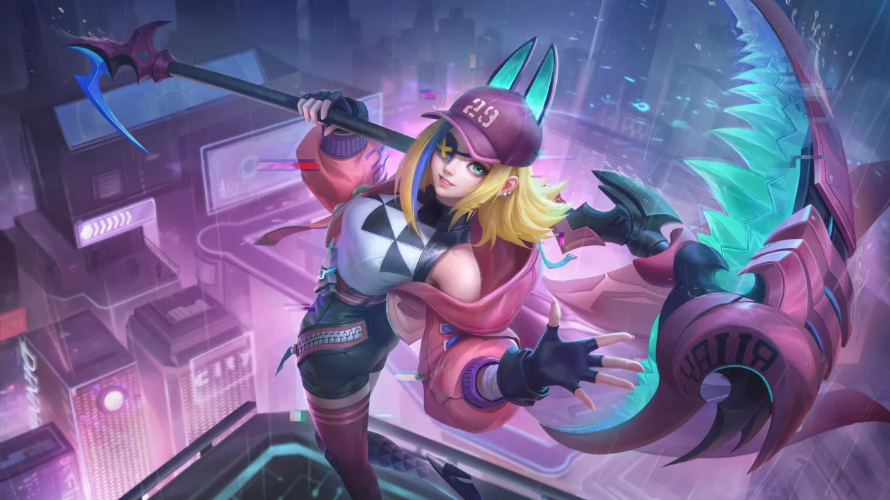

[Скины Руби](https://boostmlbb.ru/skins/ruby.html)

[Скины](https://boostmlbb.ru/skins/)/[Руби](https://boostmlbb.ru/skins/ruby.html)/Неоновый клинок

[Скин Руби](https://boostmlbb.ru/skins/ruby.html)

# Неоновый клинок

Neon Edge

Исключительный ExceptionalЗолотой месяцОграниченный

Как получить

Выходил в событии «Золотой месяц». Ограниченные облики иногда возвращаются в розыгрышах событий.

Вышел

28 февраля 2025

## Что меняет облик

-   Новая внешность
-   Новые эффекты навыков
-   Анимация показа
-   Бонус к характеристикам

## Все скины Руби [10](https://boostmlbb.ru/skins/ruby.html)

[Неоновый клинокИсключительный · 2025](https://boostmlbb.ru/skins/ruby/neon-edge.html)[Дервиш полумесяцаИсключительный · 2025](https://boostmlbb.ru/skins/ruby/crescent-dervish.html)[Жнец душИсключительный · 2024](https://boostmlbb.ru/skins/ruby/soul-reaper.html)[Меха-деваГрандиозный · 2023](https://boostmlbb.ru/skins/ruby/mecha-maiden.html)[Призмати­ческое пероИзысканный · 2023](https://boostmlbb.ru/skins/ruby/prismatic-plume.html)[Пиратский попугайИсключительный · 2021](https://boostmlbb.ru/skins/ruby/pirate-parrot.html)[Леди-зомбиИзысканный · 2019](https://boostmlbb.ru/skins/ruby/lady-zombie.html)[ЭдельвейсОбычный · 2018](https://boostmlbb.ru/skins/ruby/edelweiss.html)[КошечкаОбычный · 2017](https://boostmlbb.ru/skins/ruby/cat-girl.html)[Бабочка тайной орхидеиОбычный · 2017](https://boostmlbb.ru/skins/ruby/hidden-orchid-butterfly.html)

## Серия «Золотой месяц»

[Двойной полумесяцХанаби · 2026](https://boostmlbb.ru/skins/hanabi/twin-crescent.html)[Дервиш полумесяцаРуби · 2025](https://boostmlbb.ru/skins/ruby/crescent-dervish.html)

**Сколько стоит буст на герое Руби?**Выберите текущий и желаемый ранг. Стоимость появится на сайте.

[Рассчитать цену](https://boostmlbb.ru/order.html?type=hero)

## Частые вопросы

Как получить скин «Неоновый клинок» на Руби?

Выходил в событии «Золотой месяц». Ограниченные облики иногда возвращаются в розыгрышах событий.

Когда вышел скин «Неоновый клинок»?

28 февраля 2025.

Какой класс у скина «Неоновый клинок»?

Исключительный (Exceptional), серия «Золотой месяц».
