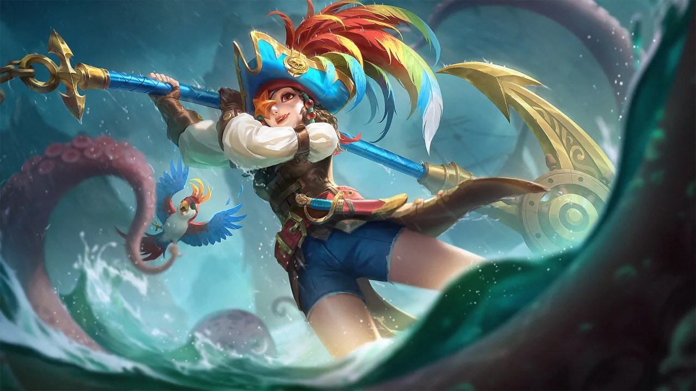
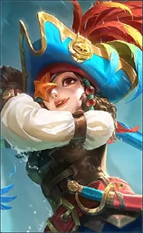

[Скины Руби](https://boostmlbb.ru/skins/ruby.html)

[Скины](https://boostmlbb.ru/skins/)/[Руби](https://boostmlbb.ru/skins/ruby.html)/Пиратский попугай

[Скин Руби](https://boostmlbb.ru/skins/ruby.html)

# Пиратский попугай

Pirate Parrot

Исключительный ExceptionalЗвёздный участникОграниченный

Как получить

Награда «Звёздного участника» в октябре 2021.

Вышел

1 октября 2021

## Что меняет облик

-   Новая внешность
-   Новые эффекты навыков
-   Анимация показа
-   Сцена показа
-   Бонус к характеристикам

## Все скины Руби [10](https://boostmlbb.ru/skins/ruby.html)

[Неоновый клинокИсключительный · 2025](https://boostmlbb.ru/skins/ruby/neon-edge.html)[Дервиш полумесяцаИсключительный · 2025](https://boostmlbb.ru/skins/ruby/crescent-dervish.html)[Жнец душИсключительный · 2024](https://boostmlbb.ru/skins/ruby/soul-reaper.html)[Меха-деваГрандиозный · 2023](https://boostmlbb.ru/skins/ruby/mecha-maiden.html)[Призмати­ческое пероИзысканный · 2023](https://boostmlbb.ru/skins/ruby/prismatic-plume.html)[Пиратский попугайИсключительный · 2021](https://boostmlbb.ru/skins/ruby/pirate-parrot.html)[Леди-зомбиИзысканный · 2019](https://boostmlbb.ru/skins/ruby/lady-zombie.html)[ЭдельвейсОбычный · 2018](https://boostmlbb.ru/skins/ruby/edelweiss.html)[КошечкаОбычный · 2017](https://boostmlbb.ru/skins/ruby/cat-girl.html)[Бабочка тайной орхидеиОбычный · 2017](https://boostmlbb.ru/skins/ruby/hidden-orchid-butterfly.html)

## Серия «Звёздный участник»

[Морячка, рождённая приливомКалеа · 2026](https://boostmlbb.ru/skins/kalea/tideborn-sailor.html)[Тень кицунэХаябуса · 2026](https://boostmlbb.ru/skins/hayabusa/kitsune-s-shadow.html)[Клыки резниХанзо · 2026](https://boostmlbb.ru/skins/hanzo/fangs-of-slaughter.html)[Тлеющая крепостьБелерик · 2026](https://boostmlbb.ru/skins/belerick/smouldering-fortress.html)[Магитех­нический призракОбсидия · 2026](https://boostmlbb.ru/skins/obsidia/magitech-wraith.html)[Элизийское сияниеЦзэтянь · 2026](https://boostmlbb.ru/skins/zetian/elysian-luminance.html)[Батальон стражейХильда · 2026](https://boostmlbb.ru/skins/hilda/guardian-battalion.html)[Мечта­тельный коиХарли · 2026](https://boostmlbb.ru/skins/harley/dreaming-koi.html)

**Сколько стоит буст на герое Руби?**Выберите текущий и желаемый ранг. Стоимость появится на сайте.

[Рассчитать цену](https://boostmlbb.ru/order.html?type=hero)

## Частые вопросы

Как получить скин «Пиратский попугай» на Руби?

Награда «Звёздного участника» в октябре 2021.

Когда вышел скин «Пиратский попугай»?

1 октября 2021.

Какой класс у скина «Пиратский попугай»?

Исключительный (Exceptional), серия «Звёздный участник».
