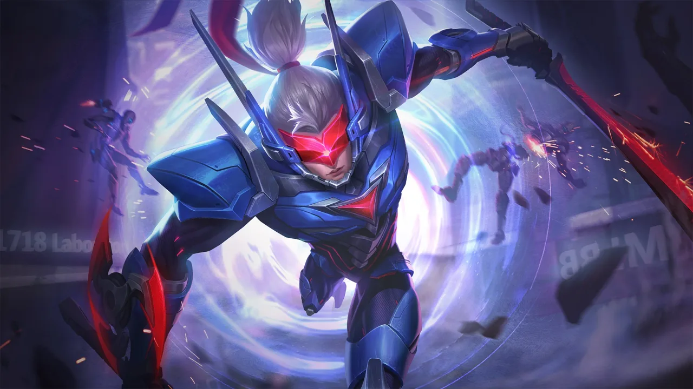
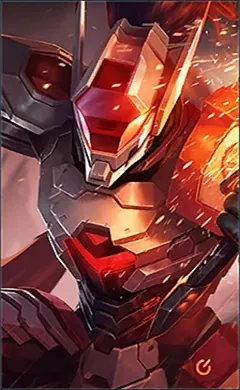
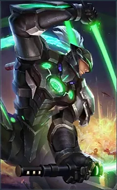

[Все скины](https://boostmlbb.ru/skins/)

[Скины](https://boostmlbb.ru/skins/)/Сабер

# Скины Сабера

Скинов

8

Можно купить

4

Последний

[Железный пёс](https://boostmlbb.ru/skins/saber/iron-hound.html)2023

[Профиль героя→](https://boostmlbb.ru/heroes/saber.html)

## Все скины

ВсеВысшийИзысканныйДелюксИсключительныйОбычный

[Железный пёсИсключительный · 2023](https://boostmlbb.ru/skins/saber/iron-hound.html)[Серебряный клинокОбычный · 2021](https://boostmlbb.ru/skins/saber/silver-edge.html)[ОнимаруИзысканный · 2019](https://boostmlbb.ru/skins/saber/onimaru.html)[Регулятор S.A.B.E.R.Делюкс · 2018](https://boostmlbb.ru/skins/saber/s-a-b-e-r-regulator.html)[Цельноме­таллический ронинОбычный · 2018](https://boostmlbb.ru/skins/saber/fullmetal-ronin.html)[Кодовое имя: ШтормВысший · 2017](https://boostmlbb.ru/skins/saber/codename-storm.html)[Воин силыИсключительный · 2016](https://boostmlbb.ru/skins/saber/force-warrior.html)[Золотая вспышкаОбычный · 2016](https://boostmlbb.ru/skins/saber/golden-flash.html)

**Сколько стоит буст на герое Сабер?**Выберите текущий и желаемый ранг. Стоимость появится на сайте.

[Рассчитать цену](https://boostmlbb.ru/order.html?type=hero)

## Частые вопросы

Сколько скинов у Сабера?

8 скинов без стандартного облика. Последний — «Железный пёс» (Iron Hound), 1 февраля 2023.

Какие скины Сабера можно купить сейчас?

«Регулятор S.A.B.E.R.» (899 алмазов), «Цельнометаллический ронин» (599 алмазов), «Золотая вспышка» (269 алмазов). Остальные облики ограниченные и возвращаются только в событиях.

Какой самый редкий скин Сабера?

«Кодовое имя: Шторм» (Codename - Storm), класс высший, серия «Легендарный». Обменивается на 200 магических кристаллов из Магического колеса.
