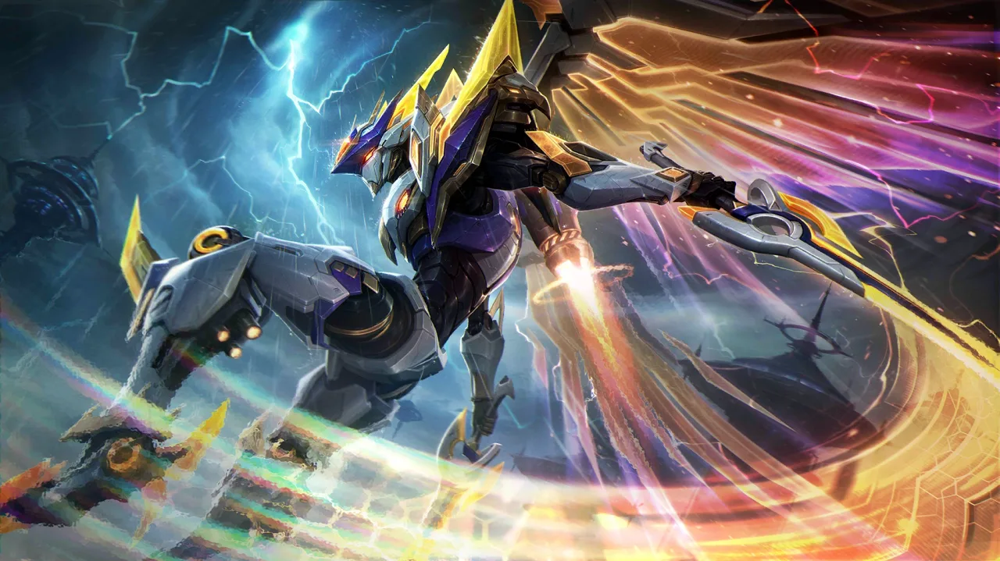

[Скины Сабера](https://boostmlbb.ru/skins/saber.html)

[Скины](https://boostmlbb.ru/skins/)/[Сабер](https://boostmlbb.ru/skins/saber.html)/Кодовое имя: Шторм

[Скин Сабера](https://boostmlbb.ru/skins/saber.html)

# Кодовое имя: Шторм

Codename - Storm

Высший SupremeЛегендарныйВ продаже

Как получить

Обменивается на 200 магических кристаллов из Магического колеса.

Цена

200 магических кристаллов

Вышел

2017 год

## Что меняет облик

-   Новая внешность
-   Новые эффекты навыков
-   Анимации навыков
-   Звуки навыков
-   Своя озвучка
-   Иконки навыков
-   Анимация показа
-   Сцена показа
-   Эффект возвращения
-   Особые действия
-   Рамка аватара
-   Достижение
-   Бонус к характеристикам

## Все скины Сабера [8](https://boostmlbb.ru/skins/saber.html)

[Железный пёсИсключительный · 2023](https://boostmlbb.ru/skins/saber/iron-hound.html)[Серебряный клинокОбычный · 2021](https://boostmlbb.ru/skins/saber/silver-edge.html)[ОнимаруИзысканный · 2019](https://boostmlbb.ru/skins/saber/onimaru.html)[Регулятор S.A.B.E.R.Делюкс · 2018](https://boostmlbb.ru/skins/saber/s-a-b-e-r-regulator.html)[Цельноме­таллический ронинОбычный · 2018](https://boostmlbb.ru/skins/saber/fullmetal-ronin.html)[Кодовое имя: ШтормВысший · 2017](https://boostmlbb.ru/skins/saber/codename-storm.html)[Воин силыИсключительный · 2016](https://boostmlbb.ru/skins/saber/force-warrior.html)[Золотая вспышкаОбычный · 2016](https://boostmlbb.ru/skins/saber/golden-flash.html)

## Серия «Легендарный»

[Призрак розАльфа · 2025](https://boostmlbb.ru/skins/alpha/revenant-of-roses.html)[Повелитель мировДжонсон · 2025](https://boostmlbb.ru/skins/johnson/sovereign-of-realms.html)[Галакти­ческая победи­тельницаФрейя · 2024](https://boostmlbb.ru/skins/freya/galactic-vanquisher.html)[Божествен­ная богиняЛюнокс · 2023](https://boostmlbb.ru/skins/lunox/divine-goddess.html)[Король адаФранко · 2023](https://boostmlbb.ru/skins/franco/king-of-hell.html)[Псион будущегоГвиневра · 2022](https://boostmlbb.ru/skins/guinevere/psion-of-tomorrow.html)[Адское пламяВалир · 2022](https://boostmlbb.ru/skins/valir/infernal-blaze.html)[Косми­ческий отблескГоссен · 2022](https://boostmlbb.ru/skins/gusion/cosmic-gleam.html)

**Сколько стоит буст на герое Сабер?**Выберите текущий и желаемый ранг. Стоимость появится на сайте.

[Рассчитать цену](https://boostmlbb.ru/order.html?type=hero)

## Частые вопросы

Как получить скин «Кодовое имя: Шторм» на Сабера?

Обменивается на 200 магических кристаллов из Магического колеса.

Когда вышел скин «Кодовое имя: Шторм»?

2017 год.

Какой класс у скина «Кодовое имя: Шторм»?

Высший (Supreme), серия «Легендарный».
