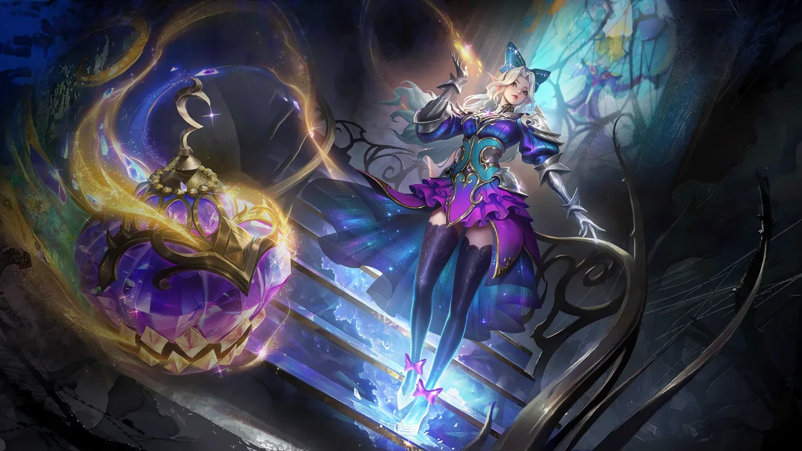

[Тир-лист](https://boostmlbb.ru/heroes/)[Предметы](https://boostmlbb.ru/items/)[Скины](https://boostmlbb.ru/skins/)[Новости и гайды](https://boostmlbb.ru/news/)

[Скины](https://boostmlbb.ru/skins/)/[Селена](https://boostmlbb.ru/skins/selena.html)/Пепельное проклятие

[Скин Селены](https://boostmlbb.ru/skins/selena.html)

# Пепельное проклятие

Curse of Cinder

Грандиозный GrandZenithОграниченный

Как получить

Выходил в событии «Zenith». Ограниченные облики иногда возвращаются в розыгрышах событий.

Вышел

10 марта 2025

## Что меняет облик

-   Новая внешность
-   Новые эффекты навыков
-   Звуки навыков
-   Своя озвучка
-   Анимация показа
-   Сцена показа
-   Музыка показа
-   Анимация появления
-   Особые действия
-   Бонус к характеристикам

## Все скины Селены [10](https://boostmlbb.ru/skins/selena.html)

[Райко Серебряная МолнияГрандиозный · 2026](https://boostmlbb.ru/skins/selena/silverbolt-raiko.html)[Пепельное проклятиеГрандиозный · 2025](https://boostmlbb.ru/skins/selena/curse-of-cinder.html)[Леди МестьГрандиозный · 2021](https://boostmlbb.ru/skins/selena/lady-vengeance.html)[Готическое проклятиеОбычный · 2021](https://boostmlbb.ru/skins/selena/gothic-curse.html)[Селена S.T.U.N.Делюкс · 2021](https://boostmlbb.ru/skins/selena/s-t-u-n-selena.html)[Громовая вспышкаИзысканный · 2020](https://boostmlbb.ru/skins/selena/thunder-flash.html)[Двойная личностьИсключительный · 2019](https://boostmlbb.ru/skins/selena/double-identity.html)[Близнецы: ТеньДелюкс · 2019](https://boostmlbb.ru/skins/selena/gemini-shadow.html)[ВирусДелюкс · 2019](https://boostmlbb.ru/skins/selena/virus.html)[Королева осОбычный · 2018](https://boostmlbb.ru/skins/selena/wasp-queen.html)

## Серия «Zenith»

[Искажённая сказкаВексана · 2024](https://boostmlbb.ru/skins/vexana/twisted-fairytale.html)

**Поднимем ранг на герое Селена**Цена считается в калькуляторе

[Рассчитать цену](https://boostmlbb.ru/order.html?type=hero)

## Частые вопросы

Как получить скин «Пепельное проклятие» на Селену?

Выходил в событии «Zenith». Ограниченные облики иногда возвращаются в розыгрышах событий.

Когда вышел скин «Пепельное проклятие»?

10 марта 2025.

Какой класс у скина «Пепельное проклятие»?

Грандиозный (Grand), серия «Zenith».
