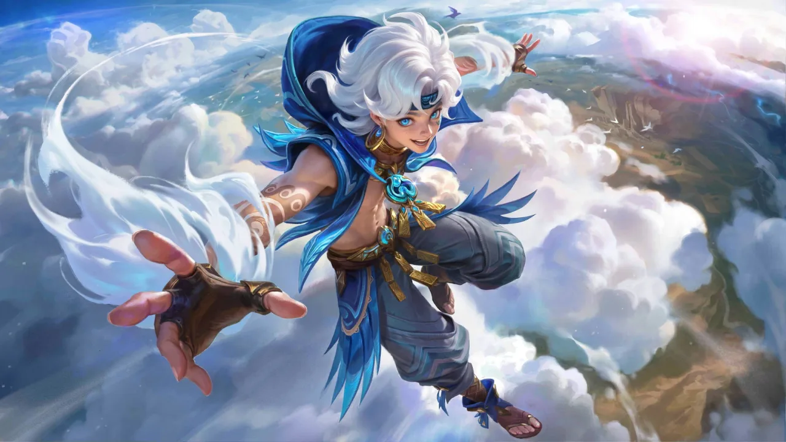
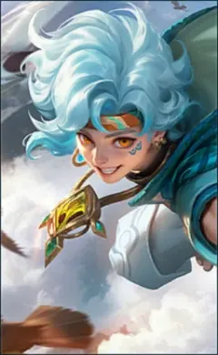

[Тир-лист](https://boostmlbb.ru/heroes/)[Предметы](https://boostmlbb.ru/items/)[Скины](https://boostmlbb.ru/skins/)[Новости и гайды](https://boostmlbb.ru/news/)

[Скины](https://boostmlbb.ru/skins/)/Сора

# Скины Соры

Скинов

1

Можно купить

1

Последний

[Лазурное облако](https://boostmlbb.ru/skins/sora/azure-cloud.html)2025

[Профиль героя→](https://boostmlbb.ru/heroes/sora.html)

## Все скины

[Лазурное облакоОбычный · 2025](https://boostmlbb.ru/skins/sora/azure-cloud.html)

**Поднимем ранг на герое Сора**Цена считается в калькуляторе

[Рассчитать цену](https://boostmlbb.ru/order.html?type=hero)

## Частые вопросы

Сколько скинов у Соры?

1 скин без стандартного облика. Последний — «Лазурное облако» (Azure Cloud), 18 декабря 2025.

Какие скины Соры можно купить сейчас?

«Лазурное облако» (269 алмазов). Остальные облики ограниченные и возвращаются только в событиях.

Какой самый редкий скин Соры?

«Лазурное облако» (Azure Cloud), класс обычный. Продаётся в магазине обликов за 269 алмазов.
