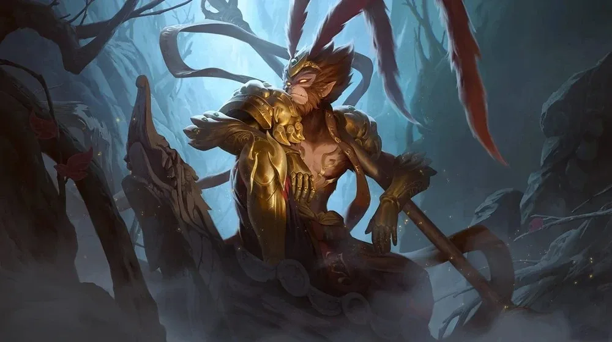

[Скины Сана](https://boostmlbb.ru/skins/sun.html)

[Скины](https://boostmlbb.ru/skins/)/[Сан](https://boostmlbb.ru/skins/sun.html)/Боевой Будда

[Скин Сана](https://boostmlbb.ru/skins/sun.html)

# Боевой Будда

Battle Buddha

Обычный CommonЭлитныйВ продаже

Как получить

Продаётся в магазине обликов за 599 алмазов.

Цена

599 алмазов

Вышел

11 августа 2017

## Что меняет облик

-   Бонус к характеристикам

## Все скины Сана [8](https://boostmlbb.ru/skins/sun.html)

[Небесный бунтарьИзысканный · 2026](https://boostmlbb.ru/skins/sun/celestial-rebel.html)[Злое пламяИзысканный · 2022](https://boostmlbb.ru/skins/sun/wicked-flames.html)[Весенние благос­ловенияДелюкс · 2022](https://boostmlbb.ru/skins/sun/spring-blessings.html)[Обезьянье проклятиеИсключительный · 2021](https://boostmlbb.ru/skins/sun/simian-curse.html)[Небесный изгойОбычный · 2020](https://boostmlbb.ru/skins/sun/celestial-outlaw.html)[Уличная легендаИсключительный · 2018](https://boostmlbb.ru/skins/sun/street-legend.html)[Боевой БуддаОбычный · 2017](https://boostmlbb.ru/skins/sun/battle-buddha.html)[Рок-звездаИсключительный · 2017](https://boostmlbb.ru/skins/sun/rock-star.html)

## Серия «Элитный»

[Золотой османтусЧан'Э · 2026](https://boostmlbb.ru/skins/change/golden-osmanthus.html)[Король-воена­чальникМартис · 2025](https://boostmlbb.ru/skins/martis/warlord-king.html)[Кадет открытого моряКимми · 2024](https://boostmlbb.ru/skins/kimmy/high-seas-cadet.html)[Зелёная копейщицаСильвана · 2024](https://boostmlbb.ru/skins/silvanna/verdant-lancer.html)[Мародёр Кровавое КопытоХилос · 2024](https://boostmlbb.ru/skins/hylos/bloodhoof-marauder.html)[Изящная бабочкаГвиневра · 2024](https://boostmlbb.ru/skins/guinevere/elegant-butterfly.html)[Маркиз клинковЛанселот · 2024](https://boostmlbb.ru/skins/lancelot/marques-of-blades.html)[Привал в пустошахЧип · 2024](https://boostmlbb.ru/skins/chip/badlands-hiatus.html)

**Сколько стоит буст на герое Сан?**Выберите текущий и желаемый ранг. Стоимость появится на сайте.

[Рассчитать цену](https://boostmlbb.ru/order.html?type=hero)

## Частые вопросы

Как получить скин «Боевой Будда» на Сана?

Продаётся в магазине обликов за 599 алмазов.

Когда вышел скин «Боевой Будда»?

11 августа 2017.

Какой класс у скина «Боевой Будда»?

Обычный (Common), серия «Элитный».
