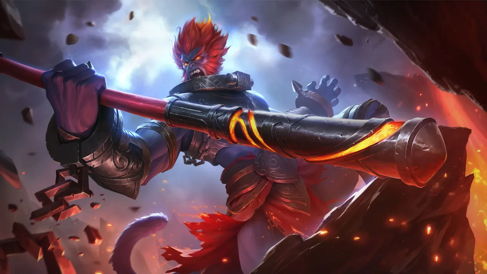

[Тир-лист](https://boostmlbb.ru/heroes/)[Предметы](https://boostmlbb.ru/items/)[Скины](https://boostmlbb.ru/skins/)[Новости и гайды](https://boostmlbb.ru/news/)

[Скины](https://boostmlbb.ru/skins/)/[Сан](https://boostmlbb.ru/skins/sun.html)/Обезьянье проклятие

[Скин Сана](https://boostmlbb.ru/skins/sun.html)

# Обезьянье проклятие

Simian Curse

Исключительный ExceptionalЗвёздный участникОграниченный

Как получить

Награда «Звёздного участника» в июле 2021.

Вышел

1 июля 2021

## Что меняет облик

-   Новая внешность
-   Новые эффекты навыков
-   Анимация показа
-   Сцена показа
-   Бонус к характеристикам

## Все скины Сана [8](https://boostmlbb.ru/skins/sun.html)

[Небесный бунтарьИзысканный · 2026](https://boostmlbb.ru/skins/sun/celestial-rebel.html)[Злое пламяИзысканный · 2022](https://boostmlbb.ru/skins/sun/wicked-flames.html)[Весенние благос­ловенияДелюкс · 2022](https://boostmlbb.ru/skins/sun/spring-blessings.html)[Обезьянье проклятиеИсключительный · 2021](https://boostmlbb.ru/skins/sun/simian-curse.html)[Небесный изгойОбычный · 2020](https://boostmlbb.ru/skins/sun/celestial-outlaw.html)[Уличная легендаИсключительный · 2018](https://boostmlbb.ru/skins/sun/street-legend.html)[Боевой БуддаОбычный · 2017](https://boostmlbb.ru/skins/sun/battle-buddha.html)[Рок-звездаИсключительный · 2017](https://boostmlbb.ru/skins/sun/rock-star.html)

## Серия «Звёздный участник»

[Морячка, рождённая приливомКалеа · 2026](https://boostmlbb.ru/skins/kalea/tideborn-sailor.html)[Тень кицунэХаябуса · 2026](https://boostmlbb.ru/skins/hayabusa/kitsune-s-shadow.html)[Клыки резниХанзо · 2026](https://boostmlbb.ru/skins/hanzo/fangs-of-slaughter.html)[Тлеющая крепостьБелерик · 2026](https://boostmlbb.ru/skins/belerick/smouldering-fortress.html)[Магитех­нический призракОбсидия · 2026](https://boostmlbb.ru/skins/obsidia/magitech-wraith.html)[Элизийское сияниеЦзэтянь · 2026](https://boostmlbb.ru/skins/zetian/elysian-luminance.html)[Батальон стражейХильда · 2026](https://boostmlbb.ru/skins/hilda/guardian-battalion.html)[Мечта­тельный коиХарли · 2026](https://boostmlbb.ru/skins/harley/dreaming-koi.html)

**Поднимем ранг на герое Сан**Цена считается в калькуляторе

[Рассчитать цену](https://boostmlbb.ru/order.html?type=hero)

## Частые вопросы

Как получить скин «Обезьянье проклятие» на Сана?

Награда «Звёздного участника» в июле 2021.

Когда вышел скин «Обезьянье проклятие»?

1 июля 2021.

Какой класс у скина «Обезьянье проклятие»?

Исключительный (Exceptional), серия «Звёздный участник».
