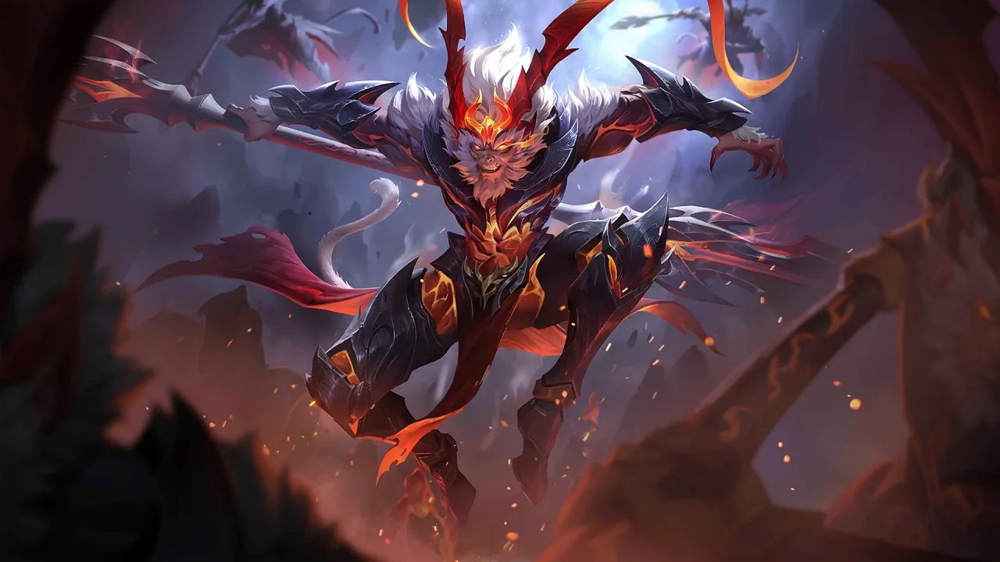

[Скины Сана](https://boostmlbb.ru/skins/sun.html)

[Скины](https://boostmlbb.ru/skins/)/[Сан](https://boostmlbb.ru/skins/sun.html)/Злое пламя

[Скин Сана](https://boostmlbb.ru/skins/sun.html)

# Злое пламя

Wicked Flames

Изысканный ExquisiteКоллекционныйОграниченный

Как получить

Главный приз розыгрыша в коллекционном событии, попытки покупаются за алмазы. Ограниченные облики иногда возвращаются в розыгрышах событий.

Вышел

3 августа 2022

## Что меняет облик

-   Новая внешность
-   Новые эффекты навыков
-   Звуки навыков
-   Своя озвучка
-   Анимация показа
-   Сцена показа
-   Бонус к характеристикам

## Все скины Сана [8](https://boostmlbb.ru/skins/sun.html)

[Небесный бунтарьИзысканный · 2026](https://boostmlbb.ru/skins/sun/celestial-rebel.html)[Злое пламяИзысканный · 2022](https://boostmlbb.ru/skins/sun/wicked-flames.html)[Весенние благос­ловенияДелюкс · 2022](https://boostmlbb.ru/skins/sun/spring-blessings.html)[Обезьянье проклятиеИсключительный · 2021](https://boostmlbb.ru/skins/sun/simian-curse.html)[Небесный изгойОбычный · 2020](https://boostmlbb.ru/skins/sun/celestial-outlaw.html)[Уличная легендаИсключительный · 2018](https://boostmlbb.ru/skins/sun/street-legend.html)[Боевой БуддаОбычный · 2017](https://boostmlbb.ru/skins/sun/battle-buddha.html)[Рок-звездаИсключительный · 2017](https://boostmlbb.ru/skins/sun/rock-star.html)

## Серия «Коллекционный»

[ОчистительБруно · 2026](https://boostmlbb.ru/skins/bruno/the-purifier.html)[Небесный бунтарьСан · 2026](https://boostmlbb.ru/skins/sun/celestial-rebel.html)[Кайдзю глубинХелкарт · 2026](https://boostmlbb.ru/skins/helcurt/kaiju-of-the-deep.html)[Звёздный дозорныйКимми · 2026](https://boostmlbb.ru/skins/kimmy/starbound-sentry.html)[Монархиня грёзАлиса · 2026](https://boostmlbb.ru/skins/alice/dreaming-monarch.html)[Дрожь глубинГрок · 2026](https://boostmlbb.ru/skins/grock/tremor-of-the-deep.html)[Небесный генералТигрил · 2026](https://boostmlbb.ru/skins/tigreal/celestial-general.html)[Монарх, рождённый солнцемКсавьер · 2026](https://boostmlbb.ru/skins/xavier/sunborn-monarch.html)

**Сколько стоит буст на герое Сан?**Выберите текущий и желаемый ранг. Стоимость появится на сайте.

[Рассчитать цену](https://boostmlbb.ru/order.html?type=hero)

## Частые вопросы

Как получить скин «Злое пламя» на Сана?

Главный приз розыгрыша в коллекционном событии, попытки покупаются за алмазы. Ограниченные облики иногда возвращаются в розыгрышах событий.

Когда вышел скин «Злое пламя»?

3 августа 2022.

Какой класс у скина «Злое пламя»?

Изысканный (Exquisite), серия «Коллекционный».
