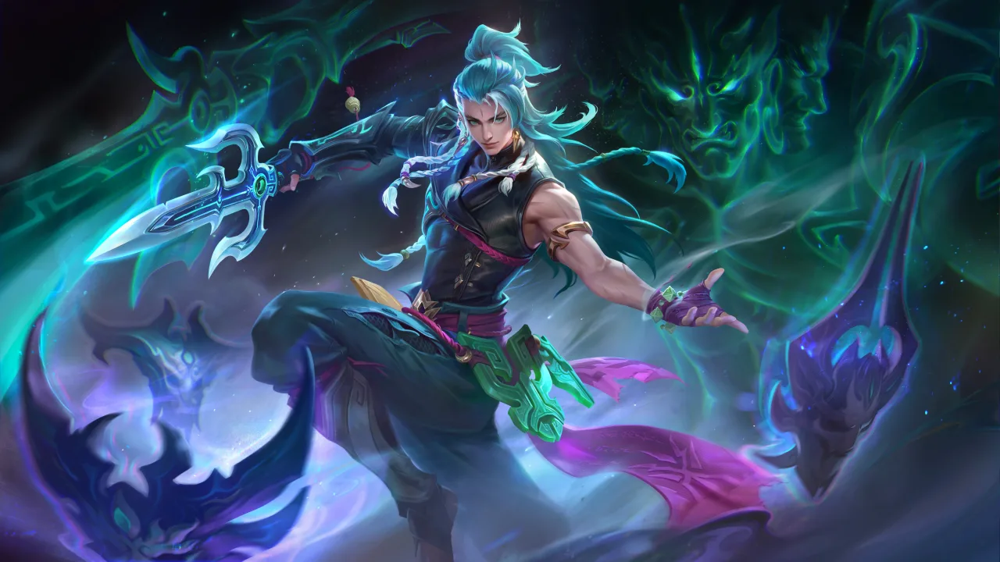

[Тир-лист](https://boostmlbb.ru/heroes/)[Предметы](https://boostmlbb.ru/items/)[Скины](https://boostmlbb.ru/skins/)[Новости и гайды](https://boostmlbb.ru/news/)

[Скины](https://boostmlbb.ru/skins/)/Су Ё

# Скины Су Ё

Скинов

2

Можно купить

1

Последний

[Саске Учиха](https://boostmlbb.ru/skins/suyou/sasuke-uchiha.html)2025

[Профиль героя→](https://boostmlbb.ru/heroes/suyou.html)

## Все скины

[Саске УчихаГрандиозный · 2025](https://boostmlbb.ru/skins/suyou/sasuke-uchiha.html)[Почтенная бди­тельностьОбычный · 2024](https://boostmlbb.ru/skins/suyou/venerated-vigilance.html)

**Поднимем ранг на герое Су Ё**Цена считается в калькуляторе

[Рассчитать цену](https://boostmlbb.ru/order.html?type=hero)

## Частые вопросы

Сколько скинов у Су Ё?

2 скина без стандартного облика. Последний — «Саске Учиха» (Sasuke Uchiha), 2 мая 2025.

Какие скины Су Ё можно купить сейчас?

«Почтенная бдительность» (269 алмазов). Остальные облики ограниченные и возвращаются только в событиях.

Какой самый редкий скин Су Ё?

«Саске Учиха» (Sasuke Uchiha), класс грандиозный, серия «Наруто». Выходил в событии коллаборации MLBB × Наруто. Ограниченные облики иногда возвращаются в розыгрышах событий.
