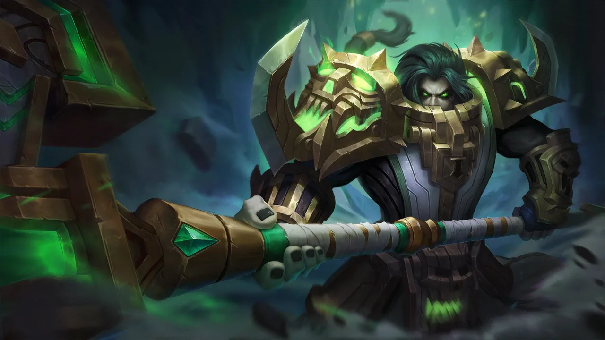

[Скины Тэризлы](https://boostmlbb.ru/skins/terizla.html)

[Скины](https://boostmlbb.ru/skins/)/[Тэризла](https://boostmlbb.ru/skins/terizla.html)/Страж бездны

[Скин Тэризлы](https://boostmlbb.ru/skins/terizla.html)

# Страж бездны

Abyss Guard

Обычный CommonВ продаже

Как получить

Продаётся в магазине обликов за 269 алмазов.

Цена

269 алмазов

Вышел

4 июня 2019

## Что меняет облик

-   Бонус к характеристикам

## Все скины Тэризлы [6](https://boostmlbb.ru/skins/terizla.html)

[Тиран порчи душИзысканный · 2025](https://boostmlbb.ru/skins/terizla/soulblight-tyrant.html)[Пламя судаДелюкс · 2024](https://boostmlbb.ru/skins/terizla/flames-of-judgement.html)[Ржавая развалинаОбычный · 2023](https://boostmlbb.ru/skins/terizla/rustwreck.html)[ВспышкаОбычный · 2023](https://boostmlbb.ru/skins/terizla/flare.html)[Великан с молотомИсключительный · 2020](https://boostmlbb.ru/skins/terizla/hammer-giant.html)[Страж бездныОбычный · 2019](https://boostmlbb.ru/skins/terizla/abyss-guard.html)

**Сколько стоит буст на герое Тэризла?**Выберите текущий и желаемый ранг. Стоимость появится на сайте.

[Рассчитать цену](https://boostmlbb.ru/order.html?type=hero)

## Частые вопросы

Как получить скин «Страж бездны» на Тэризлу?

Продаётся в магазине обликов за 269 алмазов.

Когда вышел скин «Страж бездны»?

4 июня 2019.

Какой класс у скина «Страж бездны»?

Обычный (Common).
