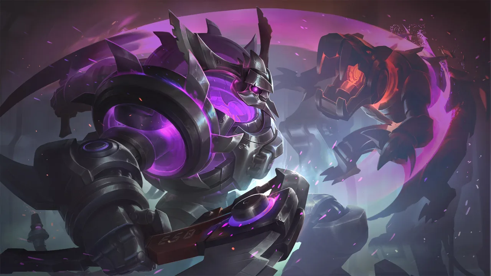
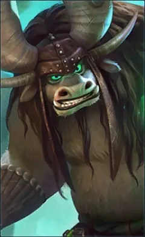

[Тир-лист](https://boostmlbb.ru/heroes/)[Предметы](https://boostmlbb.ru/items/)[Скины](https://boostmlbb.ru/skins/)[Новости и гайды](https://boostmlbb.ru/news/)

[Скины](https://boostmlbb.ru/skins/)/[Тамуз](https://boostmlbb.ru/skins/thamuz.html)/Жнец бездны

[Скин Тамуза](https://boostmlbb.ru/skins/thamuz.html)

# Жнец бездны

Abyssal Reaper

Исключительный ExceptionalОсобыйОграниченный

Как получить

Выходил в магазине обликов во время события. Ограниченные облики иногда возвращаются в розыгрышах событий.

Вышел

3 апреля 2025

## Что меняет облик

-   Новая внешность
-   Новые эффекты навыков
-   Анимация показа
-   Бонус к характеристикам

## Все скины Тамуза [6](https://boostmlbb.ru/skins/thamuz.html)

[Анниги­ляторГрандиозный · 2025](https://boostmlbb.ru/skins/thamuz/the-annihilator.html)[Жнец бездныИсключительный · 2025](https://boostmlbb.ru/skins/thamuz/abyssal-reaper.html)[Освящённое пламяИсключительный · 2023](https://boostmlbb.ru/skins/thamuz/sanctified-flame.html)[Генерал КайГрандиозный · 2023](https://boostmlbb.ru/skins/thamuz/general-kai.html)[Владыка призраковОбычный · 2022](https://boostmlbb.ru/skins/thamuz/lord-of-wraith.html)[Жидкий огоньОбычный · 2019](https://boostmlbb.ru/skins/thamuz/liquid-fire.html)

## Серия «Особый»

[Тайный вердиктМатильда · 2026](https://boostmlbb.ru/skins/mathilda/arcane-verdict.html)[Вальс на ветруВэйл · 2026](https://boostmlbb.ru/skins/vale/windborne-waltz.html)[Капитан потерянныхФранко · 2026](https://boostmlbb.ru/skins/franco/captain-of-the-lost.html)[ВолнорезЛи Сун-Син · 2025](https://boostmlbb.ru/skins/yi-sun-shin/wavebreaker.html)[Стальные рукиБаданг · 2025](https://boostmlbb.ru/skins/badang/steel-arms.html)[Леди с зонтикомКагура · 2025](https://boostmlbb.ru/skins/kagura/lady-parasol.html)[Ужас пучиныАлдос · 2025](https://boostmlbb.ru/skins/aldous/fathom-terror.html)[Труппа лунного светаЧан'Э · 2025](https://boostmlbb.ru/skins/change/moonglow-troupe.html)

**Поднимем ранг на герое Тамуз**Цена считается в калькуляторе

[Рассчитать цену](https://boostmlbb.ru/order.html?type=hero)

## Частые вопросы

Как получить скин «Жнец бездны» на Тамуза?

Выходил в магазине обликов во время события. Ограниченные облики иногда возвращаются в розыгрышах событий.

Когда вышел скин «Жнец бездны»?

3 апреля 2025.

Какой класс у скина «Жнец бездны»?

Исключительный (Exceptional), серия «Особый».
