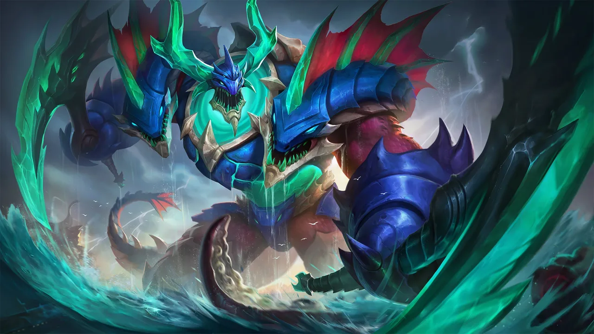
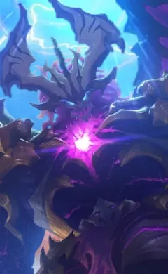

[Тир-лист](https://boostmlbb.ru/heroes/)[Предметы](https://boostmlbb.ru/items/)[Скины](https://boostmlbb.ru/skins/)[Новости и гайды](https://boostmlbb.ru/news/)

[Скины](https://boostmlbb.ru/skins/)/[Тамуз](https://boostmlbb.ru/skins/thamuz.html)/Жидкий огонь

[Скин Тамуза](https://boostmlbb.ru/skins/thamuz.html)

# Жидкий огонь

Liquid Fire

Обычный CommonЭлитныйВ продаже

Как получить

Продаётся в магазине обликов за 599 алмазов.

Цена

599 алмазов

Вышел

7 августа 2019

## Что меняет облик

-   Новая внешность
-   Другой цвет эффектов
-   Анимация показа
-   Бонус к характеристикам

## Перекраски

Тот же облик в других цветах. Перекраска открывается, только если у вас уже есть сам облик.

-   **Огненный кристалл** Fire CrystalНаграда «Звёздного участника» в августе 2021.

## Все скины Тамуза [6](https://boostmlbb.ru/skins/thamuz.html)

[Анниги­ляторГрандиозный · 2025](https://boostmlbb.ru/skins/thamuz/the-annihilator.html)[Жнец бездныИсключительный · 2025](https://boostmlbb.ru/skins/thamuz/abyssal-reaper.html)[Освящённое пламяИсключительный · 2023](https://boostmlbb.ru/skins/thamuz/sanctified-flame.html)[Генерал КайГрандиозный · 2023](https://boostmlbb.ru/skins/thamuz/general-kai.html)[Владыка призраковОбычный · 2022](https://boostmlbb.ru/skins/thamuz/lord-of-wraith.html)[Жидкий огоньОбычный · 2019](https://boostmlbb.ru/skins/thamuz/liquid-fire.html)

## Серия «Элитный»

[Золотой османтусЧан'Э · 2026](https://boostmlbb.ru/skins/change/golden-osmanthus.html)[Король-воена­чальникМартис · 2025](https://boostmlbb.ru/skins/martis/warlord-king.html)[Кадет открытого моряКимми · 2024](https://boostmlbb.ru/skins/kimmy/high-seas-cadet.html)[Зелёная копейщицаСильвана · 2024](https://boostmlbb.ru/skins/silvanna/verdant-lancer.html)[Мародёр Кровавое КопытоХилос · 2024](https://boostmlbb.ru/skins/hylos/bloodhoof-marauder.html)[Изящная бабочкаГвиневра · 2024](https://boostmlbb.ru/skins/guinevere/elegant-butterfly.html)[Маркиз клинковЛанселот · 2024](https://boostmlbb.ru/skins/lancelot/marques-of-blades.html)[Привал в пустошахЧип · 2024](https://boostmlbb.ru/skins/chip/badlands-hiatus.html)

**Поднимем ранг на герое Тамуз**Цена считается в калькуляторе

[Рассчитать цену](https://boostmlbb.ru/order.html?type=hero)

## Частые вопросы

Как получить скин «Жидкий огонь» на Тамуза?

Продаётся в магазине обликов за 599 алмазов.

Когда вышел скин «Жидкий огонь»?

7 августа 2019.

Какой класс у скина «Жидкий огонь»?

Обычный (Common), серия «Элитный».
