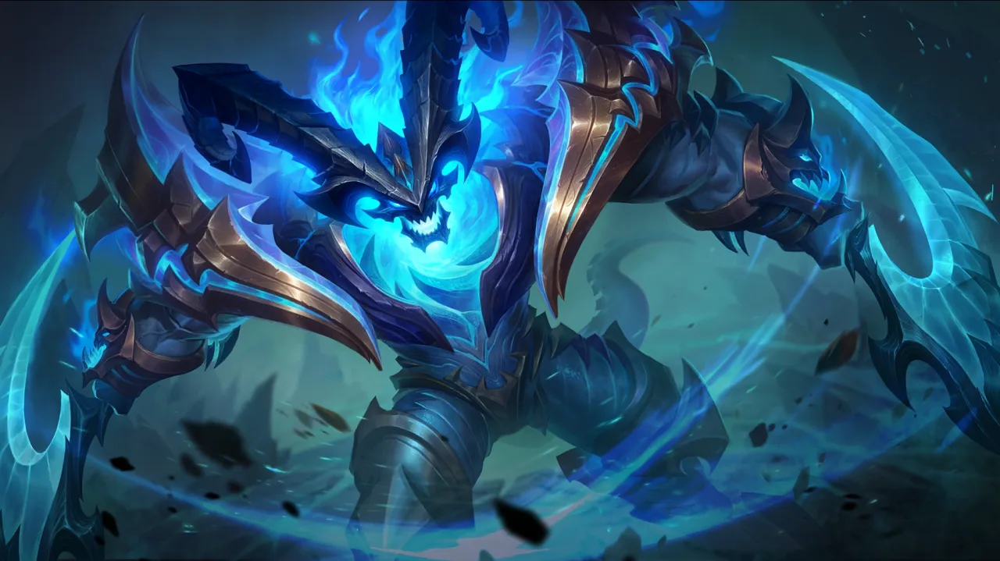

[Скины Тамуза](https://boostmlbb.ru/skins/thamuz.html)

[Скины](https://boostmlbb.ru/skins/)/[Тамуз](https://boostmlbb.ru/skins/thamuz.html)/Владыка призраков

[Скин Тамуза](https://boostmlbb.ru/skins/thamuz.html)

# Владыка призраков

Lord of Wraith

Обычный CommonВ продаже

Как получить

Продаётся в магазине обликов за 269 алмазов.

Цена

269 алмазов

Вышел

22 февраля 2022

## Что меняет облик

-   Бонус к характеристикам

## Все скины Тамуза [6](https://boostmlbb.ru/skins/thamuz.html)

[Анниги­ляторГрандиозный · 2025](https://boostmlbb.ru/skins/thamuz/the-annihilator.html)[Жнец бездныИсключительный · 2025](https://boostmlbb.ru/skins/thamuz/abyssal-reaper.html)[Освящённое пламяИсключительный · 2023](https://boostmlbb.ru/skins/thamuz/sanctified-flame.html)[Генерал КайГрандиозный · 2023](https://boostmlbb.ru/skins/thamuz/general-kai.html)[Владыка призраковОбычный · 2022](https://boostmlbb.ru/skins/thamuz/lord-of-wraith.html)[Жидкий огоньОбычный · 2019](https://boostmlbb.ru/skins/thamuz/liquid-fire.html)

**Сколько стоит буст на герое Тамуз?**Выберите текущий и желаемый ранг. Стоимость появится на сайте.

[Рассчитать цену](https://boostmlbb.ru/order.html?type=hero)

## Частые вопросы

Как получить скин «Владыка призраков» на Тамуза?

Продаётся в магазине обликов за 269 алмазов.

Когда вышел скин «Владыка призраков»?

22 февраля 2022.

Какой класс у скина «Владыка призраков»?

Обычный (Common).
