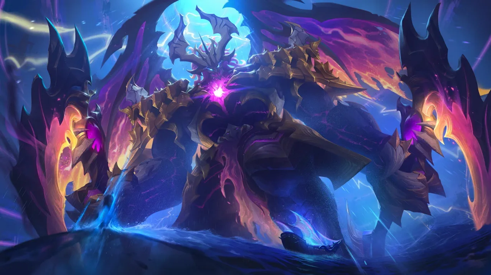

[Скины Тамуза](https://boostmlbb.ru/skins/thamuz.html)

[Скины](https://boostmlbb.ru/skins/)/[Тамуз](https://boostmlbb.ru/skins/thamuz.html)/Аннигилятор

[Скин Тамуза](https://boostmlbb.ru/skins/thamuz.html)

# Аннигилятор

The Annihilator

Грандиозный GrandМорской нексусОграниченный

Как получить

Выходил в событии «Морской нексус». Ограниченные облики иногда возвращаются в розыгрышах событий.

Вышел

5 ноября 2025

## Что меняет облик

-   Новая внешность
-   Новые эффекты навыков
-   Звуки навыков
-   Своя озвучка
-   Иконки навыков
-   Анимация показа
-   Сцена показа
-   Музыка показа
-   Анимация появления
-   Особые действия
-   Особые взаимодействия
-   Яркие спецэффекты
-   Бонус к характеристикам

## Все скины Тамуза [6](https://boostmlbb.ru/skins/thamuz.html)

[Анниги­ляторГрандиозный · 2025](https://boostmlbb.ru/skins/thamuz/the-annihilator.html)[Жнец бездныИсключительный · 2025](https://boostmlbb.ru/skins/thamuz/abyssal-reaper.html)[Освящённое пламяИсключительный · 2023](https://boostmlbb.ru/skins/thamuz/sanctified-flame.html)[Генерал КайГрандиозный · 2023](https://boostmlbb.ru/skins/thamuz/general-kai.html)[Владыка призраковОбычный · 2022](https://boostmlbb.ru/skins/thamuz/lord-of-wraith.html)[Жидкий огоньОбычный · 2019](https://boostmlbb.ru/skins/thamuz/liquid-fire.html)

**Сколько стоит буст на герое Тамуз?**Выберите текущий и желаемый ранг. Стоимость появится на сайте.

[Рассчитать цену](https://boostmlbb.ru/order.html?type=hero)

## Частые вопросы

Как получить скин «Аннигилятор» на Тамуза?

Выходил в событии «Морской нексус». Ограниченные облики иногда возвращаются в розыгрышах событий.

Когда вышел скин «Аннигилятор»?

5 ноября 2025.

Какой класс у скина «Аннигилятор»?

Грандиозный (Grand), серия «Морской нексус».
