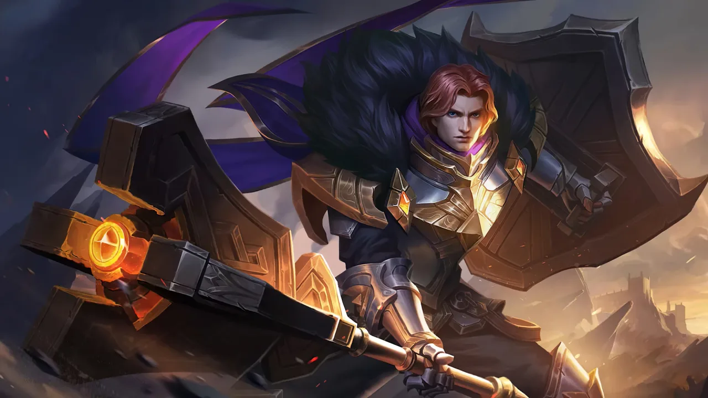
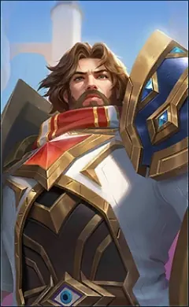

[Тир-лист](https://boostmlbb.ru/heroes/)[Предметы](https://boostmlbb.ru/items/)[Скины](https://boostmlbb.ru/skins/)[Новости и гайды](https://boostmlbb.ru/news/)

[Скины](https://boostmlbb.ru/skins/)/Тигрил

# Скины Тигрила

Скинов

9

Можно купить

5

Последний

[Небесный генерал](https://boostmlbb.ru/skins/tigreal/celestial-general.html)2026

[Профиль героя→](https://boostmlbb.ru/heroes/tigreal.html)

## Все скины

ВсеДелюксИсключительныйОбычный

[Небесный генерал2026](https://boostmlbb.ru/skins/tigreal/celestial-general.html)[Стальной стражОбычный · 2025](https://boostmlbb.ru/skins/tigreal/steel-guardian.html)[Паша правосудияИсключительный · 2024](https://boostmlbb.ru/skins/tigreal/pasha-of-justice.html)[Галакти­ческий маршалИсключительный · 2022](https://boostmlbb.ru/skins/tigreal/galactic-marshal.html)[Золотой баронИсключительный · 2021](https://boostmlbb.ru/skins/tigreal/gold-baron.html)[Рождённый светом: ЗащитникДелюкс · 2019](https://boostmlbb.ru/skins/tigreal/lightborn-defender.html)[Убийца змиевОбычный · 2018](https://boostmlbb.ru/skins/tigreal/wyrmslayer.html)[Павший стражОбычный · 2017](https://boostmlbb.ru/skins/tigreal/fallen-guard.html)[Тёмный стражОбычный · 2016](https://boostmlbb.ru/skins/tigreal/dark-guardian.html)

**Поднимем ранг на герое Тигрил**Цена считается в калькуляторе

[Рассчитать цену](https://boostmlbb.ru/order.html?type=hero)

## Частые вопросы

Сколько скинов у Тигрила?

9 скинов без стандартного облика. Последний — «Небесный генерал» (Celestial General), март 2026.

Какие скины Тигрила можно купить сейчас?

«Паша правосудия» (749 алмазов), «Золотой барон» (749 алмазов), «Рождённый светом: Защитник» (1 089 алмазов), «Павший страж» (599 алмазов), «Тёмный страж» (399 алмазов). Остальные облики ограниченные и возвращаются только в событиях.

Какой самый редкий скин Тигрила?

«Рождённый светом: Защитник» (Lightborn - Defender), класс делюкс, серия «Рождённые светом». Продаётся в магазине обликов за 1 089 алмазов.
