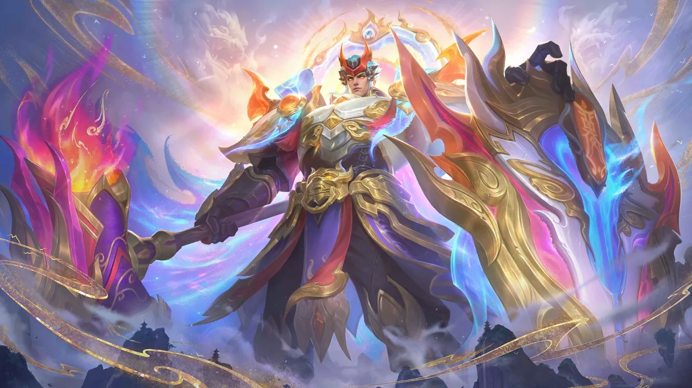
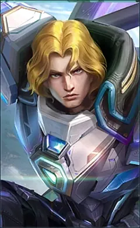

[Скины Тигрила](https://boostmlbb.ru/skins/tigreal.html)

[Скины](https://boostmlbb.ru/skins/)/[Тигрил](https://boostmlbb.ru/skins/tigreal.html)/Небесный генерал

[Скин Тигрила](https://boostmlbb.ru/skins/tigreal.html)

# Небесный генерал

Celestial General

Коллекционный

Как получить

Главный приз розыгрыша в коллекционном событии, попытки покупаются за алмазы. Ограниченные облики иногда возвращаются в розыгрышах событий.

Вышел

март 2026

## Все скины Тигрила [9](https://boostmlbb.ru/skins/tigreal.html)

[Небесный генерал2026](https://boostmlbb.ru/skins/tigreal/celestial-general.html)[Стальной стражОбычный · 2025](https://boostmlbb.ru/skins/tigreal/steel-guardian.html)[Паша правосудияИсключительный · 2024](https://boostmlbb.ru/skins/tigreal/pasha-of-justice.html)[Галакти­ческий маршалИсключительный · 2022](https://boostmlbb.ru/skins/tigreal/galactic-marshal.html)[Золотой баронИсключительный · 2021](https://boostmlbb.ru/skins/tigreal/gold-baron.html)[Рождённый светом: ЗащитникДелюкс · 2019](https://boostmlbb.ru/skins/tigreal/lightborn-defender.html)[Убийца змиевОбычный · 2018](https://boostmlbb.ru/skins/tigreal/wyrmslayer.html)[Павший стражОбычный · 2017](https://boostmlbb.ru/skins/tigreal/fallen-guard.html)[Тёмный стражОбычный · 2016](https://boostmlbb.ru/skins/tigreal/dark-guardian.html)

## Серия «Коллекционный»

[ОчистительБруно · 2026](https://boostmlbb.ru/skins/bruno/the-purifier.html)[Небесный бунтарьСан · 2026](https://boostmlbb.ru/skins/sun/celestial-rebel.html)[Кайдзю глубинХелкарт · 2026](https://boostmlbb.ru/skins/helcurt/kaiju-of-the-deep.html)[Звёздный дозорныйКимми · 2026](https://boostmlbb.ru/skins/kimmy/starbound-sentry.html)[Монархиня грёзАлиса · 2026](https://boostmlbb.ru/skins/alice/dreaming-monarch.html)[Дрожь глубинГрок · 2026](https://boostmlbb.ru/skins/grock/tremor-of-the-deep.html)[Монарх, рождённый солнцемКсавьер · 2026](https://boostmlbb.ru/skins/xavier/sunborn-monarch.html)[Похититель душЭймон · 2025](https://boostmlbb.ru/skins/aamon/soul-reaver.html)

**Сколько стоит буст на герое Тигрил?**Выберите текущий и желаемый ранг. Стоимость появится на сайте.

[Рассчитать цену](https://boostmlbb.ru/order.html?type=hero)

## Частые вопросы

Как получить скин «Небесный генерал» на Тигрила?

Главный приз розыгрыша в коллекционном событии, попытки покупаются за алмазы. Ограниченные облики иногда возвращаются в розыгрышах событий.

Когда вышел скин «Небесный генерал»?

Март 2026.
