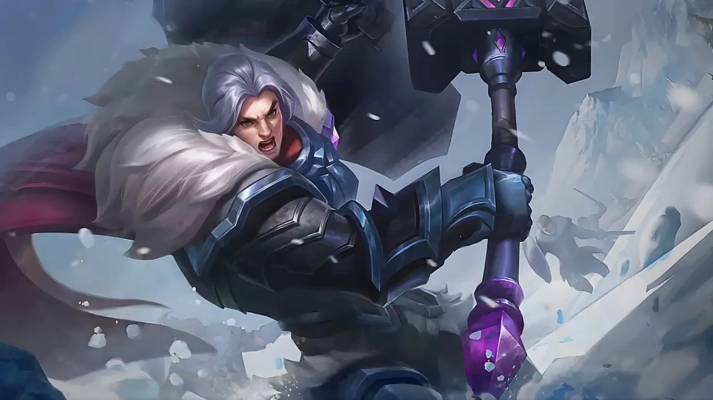

[Скины Тигрила](https://boostmlbb.ru/skins/tigreal.html)

[Скины](https://boostmlbb.ru/skins/)/[Тигрил](https://boostmlbb.ru/skins/tigreal.html)/Тёмный страж

[Скин Тигрила](https://boostmlbb.ru/skins/tigreal.html)

# Тёмный страж

Dark Guardian

Обычный CommonЭлитныйВ продаже

Как получить

Продаётся в магазине обликов за 399 алмазов.

Цена

399 алмазов

Вышел

2016 год

## Что меняет облик

-   Новая внешность
-   Бонус к характеристикам

## Все скины Тигрила [9](https://boostmlbb.ru/skins/tigreal.html)

[Небесный генерал2026](https://boostmlbb.ru/skins/tigreal/celestial-general.html)[Стальной стражОбычный · 2025](https://boostmlbb.ru/skins/tigreal/steel-guardian.html)[Паша правосудияИсключительный · 2024](https://boostmlbb.ru/skins/tigreal/pasha-of-justice.html)[Галакти­ческий маршалИсключительный · 2022](https://boostmlbb.ru/skins/tigreal/galactic-marshal.html)[Золотой баронИсключительный · 2021](https://boostmlbb.ru/skins/tigreal/gold-baron.html)[Рождённый светом: ЗащитникДелюкс · 2019](https://boostmlbb.ru/skins/tigreal/lightborn-defender.html)[Убийца змиевОбычный · 2018](https://boostmlbb.ru/skins/tigreal/wyrmslayer.html)[Павший стражОбычный · 2017](https://boostmlbb.ru/skins/tigreal/fallen-guard.html)[Тёмный стражОбычный · 2016](https://boostmlbb.ru/skins/tigreal/dark-guardian.html)

## Серия «Элитный»

[Золотой османтусЧан'Э · 2026](https://boostmlbb.ru/skins/change/golden-osmanthus.html)[Король-воена­чальникМартис · 2025](https://boostmlbb.ru/skins/martis/warlord-king.html)[Кадет открытого моряКимми · 2024](https://boostmlbb.ru/skins/kimmy/high-seas-cadet.html)[Зелёная копейщицаСильвана · 2024](https://boostmlbb.ru/skins/silvanna/verdant-lancer.html)[Мародёр Кровавое КопытоХилос · 2024](https://boostmlbb.ru/skins/hylos/bloodhoof-marauder.html)[Изящная бабочкаГвиневра · 2024](https://boostmlbb.ru/skins/guinevere/elegant-butterfly.html)[Маркиз клинковЛанселот · 2024](https://boostmlbb.ru/skins/lancelot/marques-of-blades.html)[Привал в пустошахЧип · 2024](https://boostmlbb.ru/skins/chip/badlands-hiatus.html)

**Сколько стоит буст на герое Тигрил?**Выберите текущий и желаемый ранг. Стоимость появится на сайте.

[Рассчитать цену](https://boostmlbb.ru/order.html?type=hero)

## Частые вопросы

Как получить скин «Тёмный страж» на Тигрила?

Продаётся в магазине обликов за 399 алмазов.

Когда вышел скин «Тёмный страж»?

2016 год.

Какой класс у скина «Тёмный страж»?

Обычный (Common), серия «Элитный».
