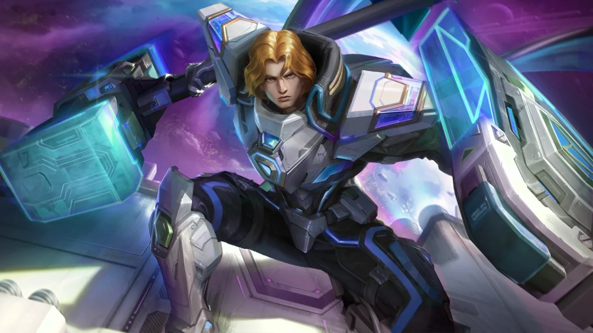

[Тир-лист](https://boostmlbb.ru/heroes/)[Предметы](https://boostmlbb.ru/items/)[Скины](https://boostmlbb.ru/skins/)[Новости и гайды](https://boostmlbb.ru/news/)

[Скины](https://boostmlbb.ru/skins/)/[Тигрил](https://boostmlbb.ru/skins/tigreal.html)/Галактический маршал

[Скин Тигрила](https://boostmlbb.ru/skins/tigreal.html)

# Галактический маршал

Galactic Marshal

Исключительный ExceptionalЗвёздный участникОграниченный

Как получить

Награда «Звёздного участника» в июне 2022.

Вышел

1 июня 2022

## Что меняет облик

-   Новая внешность
-   Новые эффекты навыков
-   Анимация показа
-   Сцена показа
-   Бонус к характеристикам

## Все скины Тигрила [9](https://boostmlbb.ru/skins/tigreal.html)

[Небесный генерал2026](https://boostmlbb.ru/skins/tigreal/celestial-general.html)[Стальной стражОбычный · 2025](https://boostmlbb.ru/skins/tigreal/steel-guardian.html)[Паша правосудияИсключительный · 2024](https://boostmlbb.ru/skins/tigreal/pasha-of-justice.html)[Галакти­ческий маршалИсключительный · 2022](https://boostmlbb.ru/skins/tigreal/galactic-marshal.html)[Золотой баронИсключительный · 2021](https://boostmlbb.ru/skins/tigreal/gold-baron.html)[Рождённый светом: ЗащитникДелюкс · 2019](https://boostmlbb.ru/skins/tigreal/lightborn-defender.html)[Убийца змиевОбычный · 2018](https://boostmlbb.ru/skins/tigreal/wyrmslayer.html)[Павший стражОбычный · 2017](https://boostmlbb.ru/skins/tigreal/fallen-guard.html)[Тёмный стражОбычный · 2016](https://boostmlbb.ru/skins/tigreal/dark-guardian.html)

## Серия «Звёздный участник»

[Морячка, рождённая приливомКалеа · 2026](https://boostmlbb.ru/skins/kalea/tideborn-sailor.html)[Тень кицунэХаябуса · 2026](https://boostmlbb.ru/skins/hayabusa/kitsune-s-shadow.html)[Клыки резниХанзо · 2026](https://boostmlbb.ru/skins/hanzo/fangs-of-slaughter.html)[Тлеющая крепостьБелерик · 2026](https://boostmlbb.ru/skins/belerick/smouldering-fortress.html)[Магитех­нический призракОбсидия · 2026](https://boostmlbb.ru/skins/obsidia/magitech-wraith.html)[Элизийское сияниеЦзэтянь · 2026](https://boostmlbb.ru/skins/zetian/elysian-luminance.html)[Батальон стражейХильда · 2026](https://boostmlbb.ru/skins/hilda/guardian-battalion.html)[Мечта­тельный коиХарли · 2026](https://boostmlbb.ru/skins/harley/dreaming-koi.html)

**Поднимем ранг на герое Тигрил**Цена считается в калькуляторе

[Рассчитать цену](https://boostmlbb.ru/order.html?type=hero)

## Частые вопросы

Как получить скин «Галактический маршал» на Тигрила?

Награда «Звёздного участника» в июне 2022.

Когда вышел скин «Галактический маршал»?

1 июня 2022.

Какой класс у скина «Галактический маршал»?

Исключительный (Exceptional), серия «Звёздный участник».
