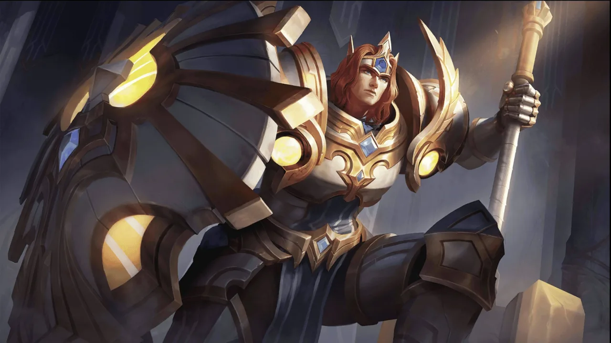

[Скины Тигрила](https://boostmlbb.ru/skins/tigreal.html)

[Скины](https://boostmlbb.ru/skins/)/[Тигрил](https://boostmlbb.ru/skins/tigreal.html)/Рождённый светом: Защитник

[Скин Тигрила](https://boostmlbb.ru/skins/tigreal.html)

# Рождённый светом: Защитник

Lightborn - Defender

Делюкс DeluxeРождённые светомВ продаже

Как получить

Продаётся в магазине обликов за 1 089 алмазов.

Цена

1 089 алмазов

Вышел

2019 год

## Что меняет облик

-   Новая внешность
-   Новые эффекты навыков
-   Анимация показа
-   Сцена показа
-   Бонус к характеристикам

## Все скины Тигрила [9](https://boostmlbb.ru/skins/tigreal.html)

[Небесный генерал2026](https://boostmlbb.ru/skins/tigreal/celestial-general.html)[Стальной стражОбычный · 2025](https://boostmlbb.ru/skins/tigreal/steel-guardian.html)[Паша правосудияИсключительный · 2024](https://boostmlbb.ru/skins/tigreal/pasha-of-justice.html)[Галакти­ческий маршалИсключительный · 2022](https://boostmlbb.ru/skins/tigreal/galactic-marshal.html)[Золотой баронИсключительный · 2021](https://boostmlbb.ru/skins/tigreal/gold-baron.html)[Рождённый светом: ЗащитникДелюкс · 2019](https://boostmlbb.ru/skins/tigreal/lightborn-defender.html)[Убийца змиевОбычный · 2018](https://boostmlbb.ru/skins/tigreal/wyrmslayer.html)[Павший стражОбычный · 2017](https://boostmlbb.ru/skins/tigreal/fallen-guard.html)[Тёмный стражОбычный · 2016](https://boostmlbb.ru/skins/tigreal/dark-guardian.html)

## Серия «Рождённые светом»

[Рождённый светом: ПодавительГрейнджер · 2024](https://boostmlbb.ru/skins/granger/lightborn-overrider.html)[Рождённая светом: РейнджерФанни · 2019](https://boostmlbb.ru/skins/fanny/lightborn-ranger.html)[Рождённый светом: УдарникАлукард · 2019](https://boostmlbb.ru/skins/alucard/lightborn-striker.html)[Рождённый светом: Вдохно­вительХарит · 2018](https://boostmlbb.ru/skins/harith/lightborn-inspirer.html)

**Сколько стоит буст на герое Тигрил?**Выберите текущий и желаемый ранг. Стоимость появится на сайте.

[Рассчитать цену](https://boostmlbb.ru/order.html?type=hero)

## Частые вопросы

Как получить скин «Рождённый светом: Защитник» на Тигрила?

Продаётся в магазине обликов за 1 089 алмазов.

Когда вышел скин «Рождённый светом: Защитник»?

2019 год.

Какой класс у скина «Рождённый светом: Защитник»?

Делюкс (Deluxe), серия «Рождённые светом».
