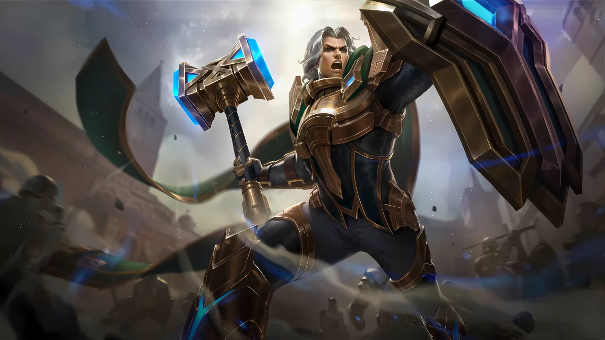

[Тир-лист](https://boostmlbb.ru/heroes/)[Предметы](https://boostmlbb.ru/items/)[Скины](https://boostmlbb.ru/skins/)[Новости и гайды](https://boostmlbb.ru/news/)

[Скины](https://boostmlbb.ru/skins/)/[Тигрил](https://boostmlbb.ru/skins/tigreal.html)/Стальной страж

[Скин Тигрила](https://boostmlbb.ru/skins/tigreal.html)

# Стальной страж

Steel Guardian

Обычный CommonОграниченный

Как получить

Выходил в ограниченном событии. Ограниченные облики иногда возвращаются в розыгрышах событий.

Вышел

14 ноября 2025

## Все скины Тигрила [9](https://boostmlbb.ru/skins/tigreal.html)

[Небесный генерал2026](https://boostmlbb.ru/skins/tigreal/celestial-general.html)[Стальной стражОбычный · 2025](https://boostmlbb.ru/skins/tigreal/steel-guardian.html)[Паша правосудияИсключительный · 2024](https://boostmlbb.ru/skins/tigreal/pasha-of-justice.html)[Галакти­ческий маршалИсключительный · 2022](https://boostmlbb.ru/skins/tigreal/galactic-marshal.html)[Золотой баронИсключительный · 2021](https://boostmlbb.ru/skins/tigreal/gold-baron.html)[Рождённый светом: ЗащитникДелюкс · 2019](https://boostmlbb.ru/skins/tigreal/lightborn-defender.html)[Убийца змиевОбычный · 2018](https://boostmlbb.ru/skins/tigreal/wyrmslayer.html)[Павший стражОбычный · 2017](https://boostmlbb.ru/skins/tigreal/fallen-guard.html)[Тёмный стражОбычный · 2016](https://boostmlbb.ru/skins/tigreal/dark-guardian.html)

**Поднимем ранг на герое Тигрил**Цена считается в калькуляторе

[Рассчитать цену](https://boostmlbb.ru/order.html?type=hero)

## Частые вопросы

Как получить скин «Стальной страж» на Тигрила?

Выходил в ограниченном событии. Ограниченные облики иногда возвращаются в розыгрышах событий.

Когда вышел скин «Стальной страж»?

14 ноября 2025.

Какой класс у скина «Стальной страж»?

Обычный (Common).
