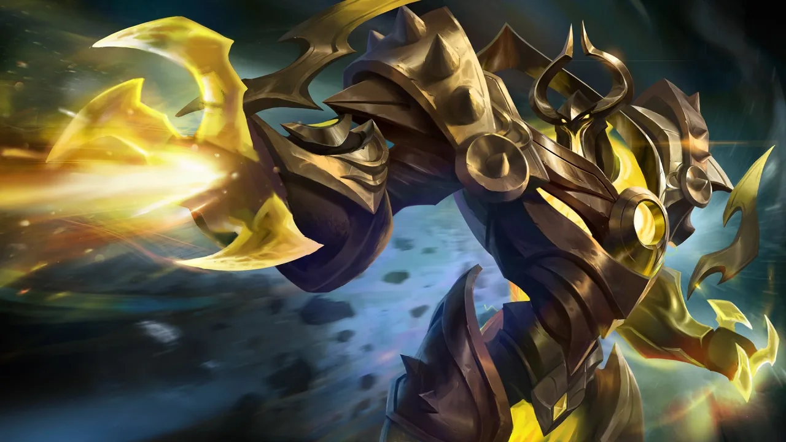
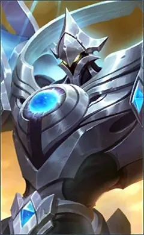

[Тир-лист](https://boostmlbb.ru/heroes/)[Предметы](https://boostmlbb.ru/items/)[Скины](https://boostmlbb.ru/skins/)[Новости и гайды](https://boostmlbb.ru/news/)

[Скины](https://boostmlbb.ru/skins/)/Уранус

# Скины Урануса

Скинов

6

Можно купить

3

Последний

[Земная реликвия](https://boostmlbb.ru/skins/uranus/earthen-relic.html)2023

[Профиль героя→](https://boostmlbb.ru/heroes/uranus.html)

## Все скины

[Земная реликвияОбычный · 2023](https://boostmlbb.ru/skins/uranus/earthen-relic.html)[ПинболИсключительный · 2022](https://boostmlbb.ru/skins/uranus/pinball-machine.html)[Небесный бастионДелюкс · 2022](https://boostmlbb.ru/skins/uranus/celestial-bastion.html)[Повелитель видеоигрИзысканный · 2020](https://boostmlbb.ru/skins/uranus/video-game-dominator.html)[Механи­ческий защитникИсключительный · 2019](https://boostmlbb.ru/skins/uranus/mech-protector.html)[Древняя душаОбычный · 2018](https://boostmlbb.ru/skins/uranus/ancient-soul.html)

**Поднимем ранг на герое Уранус**Цена считается в калькуляторе

[Рассчитать цену](https://boostmlbb.ru/order.html?type=hero)

## Частые вопросы

Сколько скинов у Урануса?

6 скинов без стандартного облика. Последний — «Земная реликвия» (Earthen Relic), 16 апреля 2023.

Какие скины Урануса можно купить сейчас?

«Пинбол» (749 алмазов), «Небесный бастион» (899 алмазов), «Древняя душа» (269 алмазов). Остальные облики ограниченные и возвращаются только в событиях.

Какой самый редкий скин Урануса?

«Повелитель видеоигр» (Video-Game Dominator), класс изысканный, серия «Ящик удачи». Выпадал из ящиков удачи в событиях. Ограниченные облики иногда возвращаются в розыгрышах событий.
