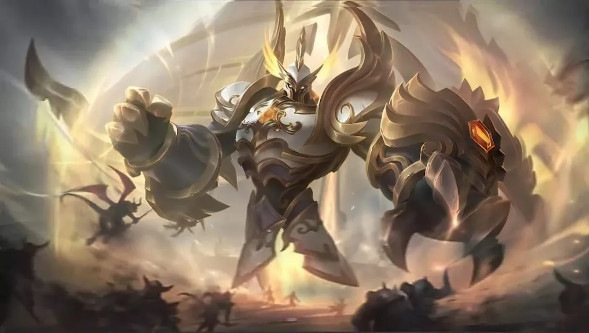

[Скины Урануса](https://boostmlbb.ru/skins/uranus.html)

[Скины](https://boostmlbb.ru/skins/)/[Уранус](https://boostmlbb.ru/skins/uranus.html)/Небесный бастион

[Скин Урануса](https://boostmlbb.ru/skins/uranus.html)

# Небесный бастион

Celestial Bastion

Делюкс DeluxeЭпическийВ продаже

Как получить

Продаётся в магазине обликов за 899 алмазов.

Цена

899 алмазов

Вышел

6 января 2022

## Что меняет облик

-   Новая внешность
-   Новые эффекты навыков
-   Анимация показа
-   Сцена показа
-   Бонус к характеристикам

## Все скины Урануса [6](https://boostmlbb.ru/skins/uranus.html)

[Земная реликвияОбычный · 2023](https://boostmlbb.ru/skins/uranus/earthen-relic.html)[ПинболИсключительный · 2022](https://boostmlbb.ru/skins/uranus/pinball-machine.html)[Небесный бастионДелюкс · 2022](https://boostmlbb.ru/skins/uranus/celestial-bastion.html)[Повелитель видеоигрИзысканный · 2020](https://boostmlbb.ru/skins/uranus/video-game-dominator.html)[Механи­ческий защитникИсключительный · 2019](https://boostmlbb.ru/skins/uranus/mech-protector.html)[Древняя душаОбычный · 2018](https://boostmlbb.ru/skins/uranus/ancient-soul.html)

## Серия «Эпический»

[Надзи­ратель преис­поднейМинотавр · 2026](https://boostmlbb.ru/skins/minotaur/nether-overseer.html)[Затонувшее проклятиеАтлас · 2026](https://boostmlbb.ru/skins/atlas/sunken-curse.html)[Вечная клятваВексана · 2026](https://boostmlbb.ru/skins/vexana/eternal-vow.html)[Проклятый свитокХуфра · 2025](https://boostmlbb.ru/skins/khufra/cursed-scroll.html)[Охотница за душамиНаталья · 2025](https://boostmlbb.ru/skins/natalia/soul-huntress.html)[Граф кошмаровЛеоморд · 2025](https://boostmlbb.ru/skins/leomord/nightmare-count.html)[Вершитель звёздБелерик · 2025](https://boostmlbb.ru/skins/belerick/arbiter-of-stars.html)[Хранитель ветровВэйл · 2025](https://boostmlbb.ru/skins/vale/keeper-of-the-winds.html)

**Сколько стоит буст на герое Уранус?**Выберите текущий и желаемый ранг. Стоимость появится на сайте.

[Рассчитать цену](https://boostmlbb.ru/order.html?type=hero)

## Частые вопросы

Как получить скин «Небесный бастион» на Урануса?

Продаётся в магазине обликов за 899 алмазов.

Когда вышел скин «Небесный бастион»?

6 января 2022.

Какой класс у скина «Небесный бастион»?

Делюкс (Deluxe), серия «Эпический».
