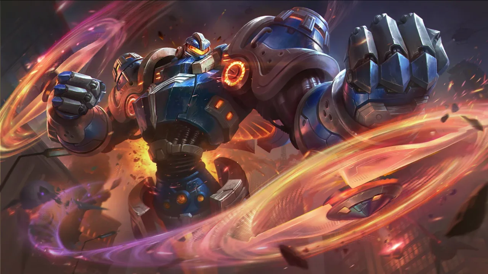

[Тир-лист](https://boostmlbb.ru/heroes/)[Предметы](https://boostmlbb.ru/items/)[Скины](https://boostmlbb.ru/skins/)[Новости и гайды](https://boostmlbb.ru/news/)

[Скины](https://boostmlbb.ru/skins/)/[Уранус](https://boostmlbb.ru/skins/uranus.html)/Механический защитник

[Скин Урануса](https://boostmlbb.ru/skins/uranus.html)

# Механический защитник

Mech Protector

Исключительный ExceptionalRisingОграниченный

Как получить

Награда турнира MLBB Rising Open.

Вышел

1 апреля 2019

## Что меняет облик

-   Новая внешность
-   Новые эффекты навыков
-   Анимация показа
-   Бонус к характеристикам

## Все скины Урануса [6](https://boostmlbb.ru/skins/uranus.html)

[Земная реликвияОбычный · 2023](https://boostmlbb.ru/skins/uranus/earthen-relic.html)[ПинболИсключительный · 2022](https://boostmlbb.ru/skins/uranus/pinball-machine.html)[Небесный бастионДелюкс · 2022](https://boostmlbb.ru/skins/uranus/celestial-bastion.html)[Повелитель видеоигрИзысканный · 2020](https://boostmlbb.ru/skins/uranus/video-game-dominator.html)[Механи­ческий защитникИсключительный · 2019](https://boostmlbb.ru/skins/uranus/mech-protector.html)[Древняя душаОбычный · 2018](https://boostmlbb.ru/skins/uranus/ancient-soul.html)

## Серия «Rising»

[ЗвездочётЛолита · 2024](https://boostmlbb.ru/skins/lolita/starwatcher.html)

**Поднимем ранг на герое Уранус**Цена считается в калькуляторе

[Рассчитать цену](https://boostmlbb.ru/order.html?type=hero)

## Частые вопросы

Как получить скин «Механический защитник» на Урануса?

Награда турнира MLBB Rising Open.

Когда вышел скин «Механический защитник»?

1 апреля 2019.

Какой класс у скина «Механический защитник»?

Исключительный (Exceptional), серия «Rising».
