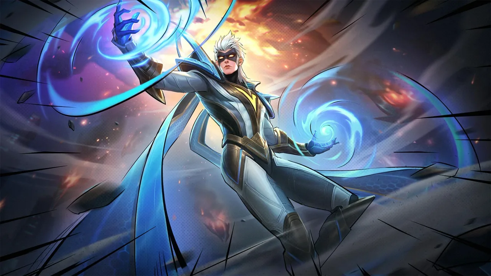

[Тир-лист](https://boostmlbb.ru/heroes/)[Предметы](https://boostmlbb.ru/items/)[Скины](https://boostmlbb.ru/skins/)[Новости и гайды](https://boostmlbb.ru/news/)

[Скины](https://boostmlbb.ru/skins/)/[Вэйл](https://boostmlbb.ru/skins/vale.html)/Снежная буря

[Скин Вэйла](https://boostmlbb.ru/skins/vale.html)

# Снежная буря

Blizzard Storm

Грандиозный GrandВосходящие звёздыОграниченный

Как получить

Выходил в событии «Восходящие звёзды». Ограниченные облики иногда возвращаются в розыгрышах событий.

Вышел

18 февраля 2023

## Что меняет облик

-   Новая внешность
-   Новые эффекты навыков
-   Звуки навыков
-   Своя озвучка
-   Анимация показа
-   Сцена показа
-   Бонус к характеристикам

## Все скины Вэйла [9](https://boostmlbb.ru/skins/vale.html)

[Вальс на ветруИсключительный · 2026](https://boostmlbb.ru/skins/vale/windborne-waltz.html)[ГаараДелюкс · 2025](https://boostmlbb.ru/skins/vale/gaara.html)[Хранитель ветровДелюкс · 2025](https://boostmlbb.ru/skins/vale/keeper-of-the-winds.html)[Концерт светаИзысканный · 2024](https://boostmlbb.ru/skins/vale/concerto-of-light.html)[КаннагиОбычный · 2023](https://boostmlbb.ru/skins/vale/kannagi.html)[Снежная буряГрандиозный · 2023](https://boostmlbb.ru/skins/vale/blizzard-storm.html)[Высшая буряИзысканный · 2022](https://boostmlbb.ru/skins/vale/supernal-tempest.html)[Парящий дэватаИсключительный · 2021](https://boostmlbb.ru/skins/vale/soaring-devata.html)[Лазурные ветраОбычный · 2019](https://boostmlbb.ru/skins/vale/cerulean-winds.html)

## Серия «Восходящие звёзды»

[Мастер мечаЛанселот · 2024](https://boostmlbb.ru/skins/lancelot/swordmaster.html)[Прорица­тельницаЭсмеральда · 2023](https://boostmlbb.ru/skins/esmeralda/the-foreseer.html)[Громовой кулакЧу · 2021](https://boostmlbb.ru/skins/chou/thunderfist.html)[Огненный разрядБруно · 2020](https://boostmlbb.ru/skins/bruno/firebolt.html)

**Поднимем ранг на герое Вэйл**Цена считается в калькуляторе

[Рассчитать цену](https://boostmlbb.ru/order.html?type=hero)

## Частые вопросы

Как получить скин «Снежная буря» на Вэйла?

Выходил в событии «Восходящие звёзды». Ограниченные облики иногда возвращаются в розыгрышах событий.

Когда вышел скин «Снежная буря»?

18 февраля 2023.

Какой класс у скина «Снежная буря»?

Грандиозный (Grand), серия «Восходящие звёзды».
