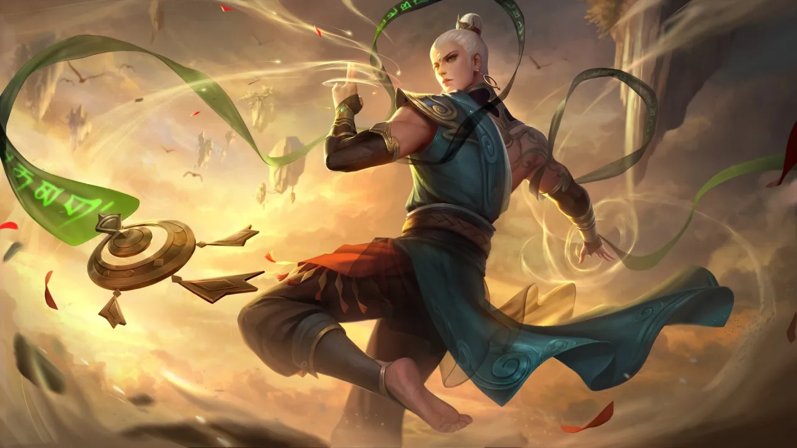

[Тир-лист](https://boostmlbb.ru/heroes/)[Предметы](https://boostmlbb.ru/items/)[Скины](https://boostmlbb.ru/skins/)[Новости и гайды](https://boostmlbb.ru/news/)

[Скины](https://boostmlbb.ru/skins/)/[Вэйл](https://boostmlbb.ru/skins/vale.html)/Парящий дэвата

[Скин Вэйла](https://boostmlbb.ru/skins/vale.html)

# Парящий дэвата

Soaring Devata

Исключительный ExceptionalЗвёздный участникОграниченный

Как получить

Награда «Звёздного участника» в ноябре 2021.

Вышел

1 ноября 2021

## Что меняет облик

-   Новая внешность
-   Новые эффекты навыков
-   Анимация показа
-   Сцена показа
-   Бонус к характеристикам

## Все скины Вэйла [9](https://boostmlbb.ru/skins/vale.html)

[Вальс на ветруИсключительный · 2026](https://boostmlbb.ru/skins/vale/windborne-waltz.html)[ГаараДелюкс · 2025](https://boostmlbb.ru/skins/vale/gaara.html)[Хранитель ветровДелюкс · 2025](https://boostmlbb.ru/skins/vale/keeper-of-the-winds.html)[Концерт светаИзысканный · 2024](https://boostmlbb.ru/skins/vale/concerto-of-light.html)[КаннагиОбычный · 2023](https://boostmlbb.ru/skins/vale/kannagi.html)[Снежная буряГрандиозный · 2023](https://boostmlbb.ru/skins/vale/blizzard-storm.html)[Высшая буряИзысканный · 2022](https://boostmlbb.ru/skins/vale/supernal-tempest.html)[Парящий дэватаИсключительный · 2021](https://boostmlbb.ru/skins/vale/soaring-devata.html)[Лазурные ветраОбычный · 2019](https://boostmlbb.ru/skins/vale/cerulean-winds.html)

## Серия «Звёздный участник»

[Морячка, рождённая приливомКалеа · 2026](https://boostmlbb.ru/skins/kalea/tideborn-sailor.html)[Тень кицунэХаябуса · 2026](https://boostmlbb.ru/skins/hayabusa/kitsune-s-shadow.html)[Клыки резниХанзо · 2026](https://boostmlbb.ru/skins/hanzo/fangs-of-slaughter.html)[Тлеющая крепостьБелерик · 2026](https://boostmlbb.ru/skins/belerick/smouldering-fortress.html)[Магитех­нический призракОбсидия · 2026](https://boostmlbb.ru/skins/obsidia/magitech-wraith.html)[Элизийское сияниеЦзэтянь · 2026](https://boostmlbb.ru/skins/zetian/elysian-luminance.html)[Батальон стражейХильда · 2026](https://boostmlbb.ru/skins/hilda/guardian-battalion.html)[Мечта­тельный коиХарли · 2026](https://boostmlbb.ru/skins/harley/dreaming-koi.html)

**Поднимем ранг на герое Вэйл**Цена считается в калькуляторе

[Рассчитать цену](https://boostmlbb.ru/order.html?type=hero)

## Частые вопросы

Как получить скин «Парящий дэвата» на Вэйла?

Награда «Звёздного участника» в ноябре 2021.

Когда вышел скин «Парящий дэвата»?

1 ноября 2021.

Какой класс у скина «Парящий дэвата»?

Исключительный (Exceptional), серия «Звёздный участник».
