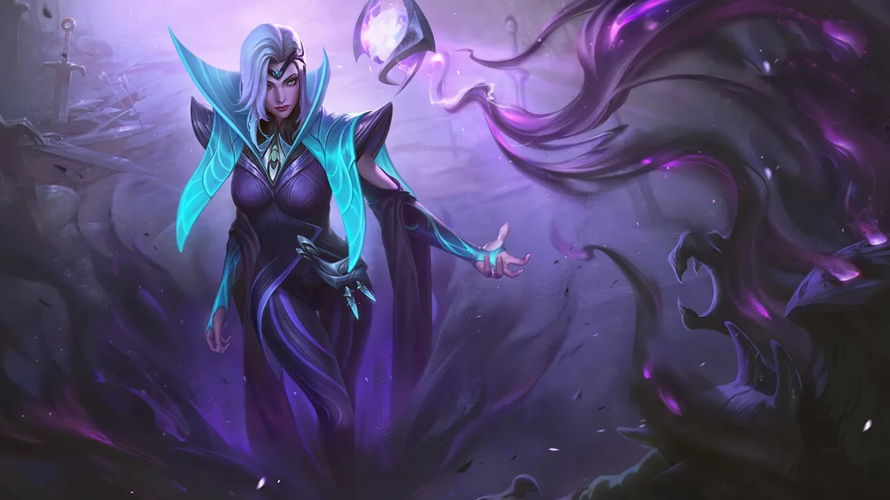

[Все скины](https://boostmlbb.ru/skins/)

[Скины](https://boostmlbb.ru/skins/)/Валентина

# Скины Валентины

Скинов

6

Можно купить

2

Последний

[Большой гала-вечер](https://boostmlbb.ru/skins/valentina/grand-gala.html)2025

[Профиль героя→](https://boostmlbb.ru/heroes/valentina.html)

## Все скины

[Большой гала-вечерОбычный · 2025](https://boostmlbb.ru/skins/valentina/grand-gala.html)[Тёмный нексусДелюкс · 2024](https://boostmlbb.ru/skins/valentina/dark-nexus.html)[Небесная судьяИзысканный · 2023](https://boostmlbb.ru/skins/valentina/celestial-judicator.html)[Кибер-агентИсключительный · 2023](https://boostmlbb.ru/skins/valentina/cyber-agent.html)[Архима­гистрОбычный · 2022](https://boostmlbb.ru/skins/valentina/archmagister.html)[Сумеречная чаровницаОбычный · 2021](https://boostmlbb.ru/skins/valentina/twilight-charmer.html)

**Сколько стоит буст на герое Валентина?**Выберите текущий и желаемый ранг. Стоимость появится на сайте.

[Рассчитать цену](https://boostmlbb.ru/order.html?type=hero)

## Частые вопросы

Сколько скинов у Валентины?

6 скинов без стандартного облика. Последний — «Большой гала-вечер» (Grand Gala), 17 сентября 2025.

Какие скины Валентины можно купить сейчас?

«Архимагистр» (599 алмазов), «Сумеречная чаровница» (269 алмазов). Остальные облики ограниченные и возвращаются только в событиях.

Какой самый редкий скин Валентины?

«Небесная судья» (Celestial Judicator), класс изысканный, серия «Коллекционный». Главный приз розыгрыша в коллекционном событии, попытки покупаются за алмазы. Ограниченные облики иногда возвращаются в розыгрышах событий.
