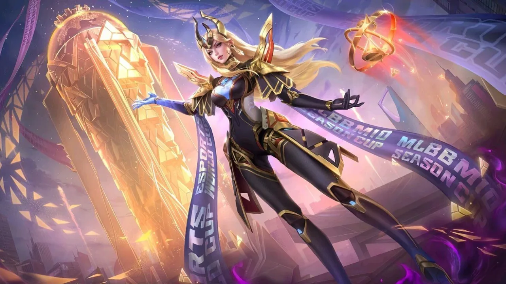
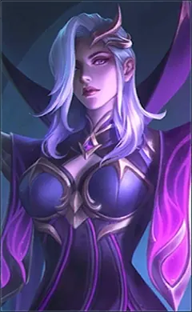

[Скины Валентины](https://boostmlbb.ru/skins/valentina.html)

[Скины](https://boostmlbb.ru/skins/)/[Валентина](https://boostmlbb.ru/skins/valentina.html)/Тёмный нексус

[Скин Валентины](https://boostmlbb.ru/skins/valentina.html)

# Тёмный нексус

Dark Nexus

Делюкс DeluxeMSC 2024Ограниченный

Как получить

Киберспортивный облик (MSC 2024): выходил в событии турнира. Ограниченные облики иногда возвращаются в розыгрышах событий.

Вышел

26 июня 2024

## Что меняет облик

-   Новая внешность
-   Новые эффекты навыков
-   Звуки навыков
-   Анимация показа
-   Сцена показа
-   Музыка показа
-   Бонус к характеристикам

## Все скины Валентины [6](https://boostmlbb.ru/skins/valentina.html)

[Большой гала-вечерОбычный · 2025](https://boostmlbb.ru/skins/valentina/grand-gala.html)[Тёмный нексусДелюкс · 2024](https://boostmlbb.ru/skins/valentina/dark-nexus.html)[Небесная судьяИзысканный · 2023](https://boostmlbb.ru/skins/valentina/celestial-judicator.html)[Кибер-агентИсключительный · 2023](https://boostmlbb.ru/skins/valentina/cyber-agent.html)[Архима­гистрОбычный · 2022](https://boostmlbb.ru/skins/valentina/archmagister.html)[Сумеречная чаровницаОбычный · 2021](https://boostmlbb.ru/skins/valentina/twilight-charmer.html)

**Сколько стоит буст на герое Валентина?**Выберите текущий и желаемый ранг. Стоимость появится на сайте.

[Рассчитать цену](https://boostmlbb.ru/order.html?type=hero)

## Частые вопросы

Как получить скин «Тёмный нексус» на Валентину?

Киберспортивный облик (MSC 2024): выходил в событии турнира. Ограниченные облики иногда возвращаются в розыгрышах событий.

Когда вышел скин «Тёмный нексус»?

26 июня 2024.

Какой класс у скина «Тёмный нексус»?

Делюкс (Deluxe), серия «MSC 2024».
