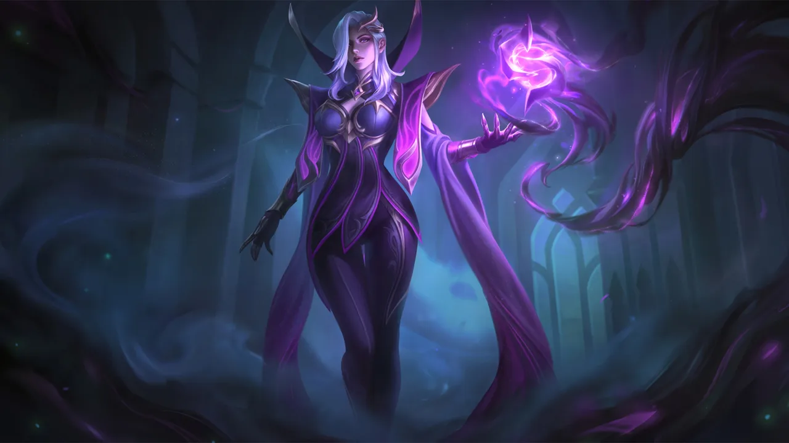

[Тир-лист](https://boostmlbb.ru/heroes/)[Предметы](https://boostmlbb.ru/items/)[Скины](https://boostmlbb.ru/skins/)[Новости и гайды](https://boostmlbb.ru/news/)

[Скины](https://boostmlbb.ru/skins/)/[Валентина](https://boostmlbb.ru/skins/valentina.html)/Сумеречная чаровница

[Скин Валентины](https://boostmlbb.ru/skins/valentina.html)

# Сумеречная чаровница

Twilight Charmer

Обычный CommonВ продаже

Как получить

Продаётся в магазине обликов за 269 алмазов.

Цена

269 алмазов

Вышел

25 ноября 2021

## Что меняет облик

-   Бонус к характеристикам

## Все скины Валентины [6](https://boostmlbb.ru/skins/valentina.html)

[Большой гала-вечерОбычный · 2025](https://boostmlbb.ru/skins/valentina/grand-gala.html)[Тёмный нексусДелюкс · 2024](https://boostmlbb.ru/skins/valentina/dark-nexus.html)[Небесная судьяИзысканный · 2023](https://boostmlbb.ru/skins/valentina/celestial-judicator.html)[Кибер-агентИсключительный · 2023](https://boostmlbb.ru/skins/valentina/cyber-agent.html)[Архима­гистрОбычный · 2022](https://boostmlbb.ru/skins/valentina/archmagister.html)[Сумеречная чаровницаОбычный · 2021](https://boostmlbb.ru/skins/valentina/twilight-charmer.html)

**Поднимем ранг на герое Валентина**Цена считается в калькуляторе

[Рассчитать цену](https://boostmlbb.ru/order.html?type=hero)

## Частые вопросы

Как получить скин «Сумеречная чаровница» на Валентину?

Продаётся в магазине обликов за 269 алмазов.

Когда вышел скин «Сумеречная чаровница»?

25 ноября 2021.

Какой класс у скина «Сумеречная чаровница»?

Обычный (Common).
