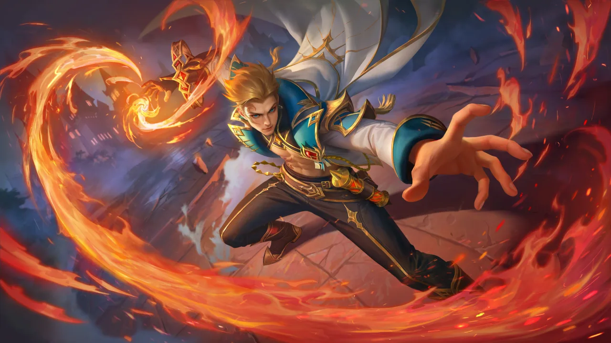

[Скины Валира](https://boostmlbb.ru/skins/valir.html)

[Скины](https://boostmlbb.ru/skins/)/[Валир](https://boostmlbb.ru/skins/valir.html)/Искатель тайн

[Скин Валира](https://boostmlbb.ru/skins/valir.html)

# Искатель тайн

Arcane Seeker

Обычный CommonЭлитныйОграниченный

Как получить

Выходил в магазине обликов во время события. Ограниченные облики иногда возвращаются в розыгрышах событий.

Вышел

август 2018

## Что меняет облик

-   Новая внешность
-   Другой цвет эффектов
-   Анимация показа
-   Бонус к характеристикам

## Все скины Валира [10](https://boostmlbb.ru/skins/valir.html)

[Кё КусанагиГрандиозный · 2024](https://boostmlbb.ru/skins/valir/kyo-kusanagi.html)[Феникс ИккиДелюкс · 2022](https://boostmlbb.ru/skins/valir/phoenix-ikki.html)[Лев ИккиГрандиозный · 2022](https://boostmlbb.ru/skins/valir/leo-ikki.html)[Призы­ватель сикигамиИсключительный · 2022](https://boostmlbb.ru/skins/valir/shikigami-sumonner.html)[Адское пламяВысший · 2022](https://boostmlbb.ru/skins/valir/infernal-blaze.html)[Повелитель демоновИзысканный · 2021](https://boostmlbb.ru/skins/valir/demonlord.html)[ДиктаторИсключительный · 2020](https://boostmlbb.ru/skins/valir/dictator.html)[Драконье пламяДелюкс · 2019](https://boostmlbb.ru/skins/valir/draconic-flame.html)[Искатель тайнОбычный · 2018](https://boostmlbb.ru/skins/valir/arcane-seeker.html)[Бледное пламяОбычный · 2018](https://boostmlbb.ru/skins/valir/pale-flame.html)

## Серия «Элитный»

[Золотой османтусЧан'Э · 2026](https://boostmlbb.ru/skins/change/golden-osmanthus.html)[Король-воена­чальникМартис · 2025](https://boostmlbb.ru/skins/martis/warlord-king.html)[Кадет открытого моряКимми · 2024](https://boostmlbb.ru/skins/kimmy/high-seas-cadet.html)[Зелёная копейщицаСильвана · 2024](https://boostmlbb.ru/skins/silvanna/verdant-lancer.html)[Мародёр Кровавое КопытоХилос · 2024](https://boostmlbb.ru/skins/hylos/bloodhoof-marauder.html)[Изящная бабочкаГвиневра · 2024](https://boostmlbb.ru/skins/guinevere/elegant-butterfly.html)[Маркиз клинковЛанселот · 2024](https://boostmlbb.ru/skins/lancelot/marques-of-blades.html)[Привал в пустошахЧип · 2024](https://boostmlbb.ru/skins/chip/badlands-hiatus.html)

**Сколько стоит буст на герое Валир?**Выберите текущий и желаемый ранг. Стоимость появится на сайте.

[Рассчитать цену](https://boostmlbb.ru/order.html?type=hero)

## Частые вопросы

Как получить скин «Искатель тайн» на Валира?

Выходил в магазине обликов во время события. Ограниченные облики иногда возвращаются в розыгрышах событий.

Когда вышел скин «Искатель тайн»?

Август 2018.

Какой класс у скина «Искатель тайн»?

Обычный (Common), серия «Элитный».
