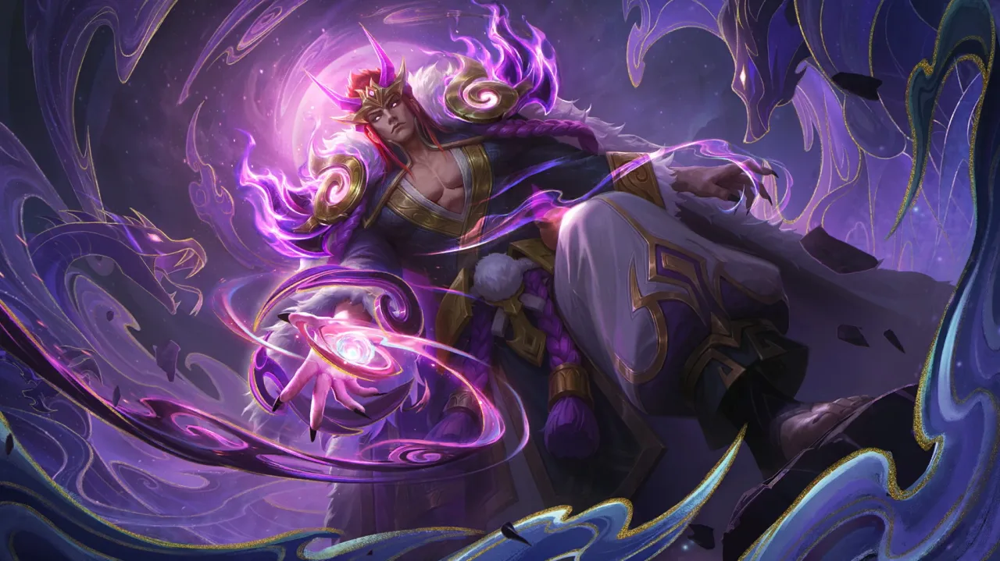
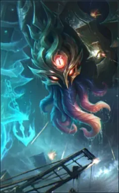

[Тир-лист](https://boostmlbb.ru/heroes/)[Предметы](https://boostmlbb.ru/items/)[Скины](https://boostmlbb.ru/skins/)[Новости и гайды](https://boostmlbb.ru/news/)

[Скины](https://boostmlbb.ru/skins/)/[Валир](https://boostmlbb.ru/skins/valir.html)/Повелитель демонов

[Скин Валира](https://boostmlbb.ru/skins/valir.html)

# Повелитель демонов

Demonlord

Изысканный ExquisiteКоллекционныйОграниченный

Как получить

Главный приз розыгрыша в коллекционном событии, попытки покупаются за алмазы. Ограниченные облики иногда возвращаются в розыгрышах событий.

Вышел

январь 2021

## Что меняет облик

-   Новая внешность
-   Новые эффекты навыков
-   Звуки навыков
-   Своя озвучка
-   Анимация показа
-   Сцена показа
-   Бонус к характеристикам

## Все скины Валира [10](https://boostmlbb.ru/skins/valir.html)

[Кё КусанагиГрандиозный · 2024](https://boostmlbb.ru/skins/valir/kyo-kusanagi.html)[Феникс ИккиДелюкс · 2022](https://boostmlbb.ru/skins/valir/phoenix-ikki.html)[Лев ИккиГрандиозный · 2022](https://boostmlbb.ru/skins/valir/leo-ikki.html)[Призы­ватель сикигамиИсключительный · 2022](https://boostmlbb.ru/skins/valir/shikigami-sumonner.html)[Адское пламяВысший · 2022](https://boostmlbb.ru/skins/valir/infernal-blaze.html)[Повелитель демоновИзысканный · 2021](https://boostmlbb.ru/skins/valir/demonlord.html)[ДиктаторИсключительный · 2020](https://boostmlbb.ru/skins/valir/dictator.html)[Драконье пламяДелюкс · 2019](https://boostmlbb.ru/skins/valir/draconic-flame.html)[Искатель тайнОбычный · 2018](https://boostmlbb.ru/skins/valir/arcane-seeker.html)[Бледное пламяОбычный · 2018](https://boostmlbb.ru/skins/valir/pale-flame.html)

## Серия «Коллекционный»

[ОчистительБруно · 2026](https://boostmlbb.ru/skins/bruno/the-purifier.html)[Небесный бунтарьСан · 2026](https://boostmlbb.ru/skins/sun/celestial-rebel.html)[Кайдзю глубинХелкарт · 2026](https://boostmlbb.ru/skins/helcurt/kaiju-of-the-deep.html)[Звёздный дозорныйКимми · 2026](https://boostmlbb.ru/skins/kimmy/starbound-sentry.html)[Монархиня грёзАлиса · 2026](https://boostmlbb.ru/skins/alice/dreaming-monarch.html)[Дрожь глубинГрок · 2026](https://boostmlbb.ru/skins/grock/tremor-of-the-deep.html)[Небесный генералТигрил · 2026](https://boostmlbb.ru/skins/tigreal/celestial-general.html)[Монарх, рождённый солнцемКсавьер · 2026](https://boostmlbb.ru/skins/xavier/sunborn-monarch.html)

**Поднимем ранг на герое Валир**Цена считается в калькуляторе

[Рассчитать цену](https://boostmlbb.ru/order.html?type=hero)

## Частые вопросы

Как получить скин «Повелитель демонов» на Валира?

Главный приз розыгрыша в коллекционном событии, попытки покупаются за алмазы. Ограниченные облики иногда возвращаются в розыгрышах событий.

Когда вышел скин «Повелитель демонов»?

Январь 2021.

Какой класс у скина «Повелитель демонов»?

Изысканный (Exquisite), серия «Коллекционный».
