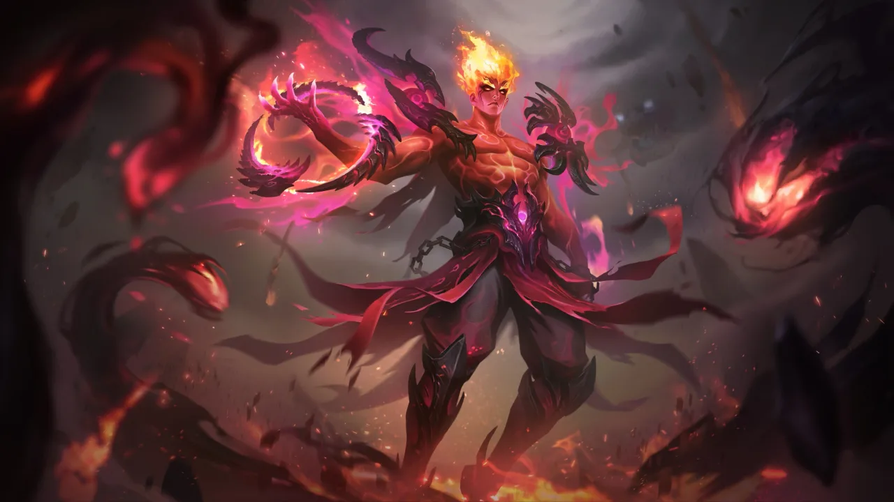

[Скины Валира](https://boostmlbb.ru/skins/valir.html)

[Скины](https://boostmlbb.ru/skins/)/[Валир](https://boostmlbb.ru/skins/valir.html)/Адское пламя

[Скин Валира](https://boostmlbb.ru/skins/valir.html)

# Адское пламя

Infernal Blaze

Высший SupremeЛегендарныйВ продаже

Как получить

Обменивается на 200 магических кристаллов из Магического колеса.

Цена

200 магических кристаллов

Вышел

6 января 2022

## Что меняет облик

-   Новая внешность
-   Новые эффекты навыков
-   Анимации навыков
-   Звуки навыков
-   Своя озвучка
-   Иконки навыков
-   Анимация показа
-   Сцена показа
-   Эффект возвращения
-   Рамка аватара
-   Достижение
-   Бонус к характеристикам

## Все скины Валира [10](https://boostmlbb.ru/skins/valir.html)

[Кё КусанагиГрандиозный · 2024](https://boostmlbb.ru/skins/valir/kyo-kusanagi.html)[Феникс ИккиДелюкс · 2022](https://boostmlbb.ru/skins/valir/phoenix-ikki.html)[Лев ИккиГрандиозный · 2022](https://boostmlbb.ru/skins/valir/leo-ikki.html)[Призы­ватель сикигамиИсключительный · 2022](https://boostmlbb.ru/skins/valir/shikigami-sumonner.html)[Адское пламяВысший · 2022](https://boostmlbb.ru/skins/valir/infernal-blaze.html)[Повелитель демоновИзысканный · 2021](https://boostmlbb.ru/skins/valir/demonlord.html)[ДиктаторИсключительный · 2020](https://boostmlbb.ru/skins/valir/dictator.html)[Драконье пламяДелюкс · 2019](https://boostmlbb.ru/skins/valir/draconic-flame.html)[Искатель тайнОбычный · 2018](https://boostmlbb.ru/skins/valir/arcane-seeker.html)[Бледное пламяОбычный · 2018](https://boostmlbb.ru/skins/valir/pale-flame.html)

## Серия «Легендарный»

[Призрак розАльфа · 2025](https://boostmlbb.ru/skins/alpha/revenant-of-roses.html)[Повелитель мировДжонсон · 2025](https://boostmlbb.ru/skins/johnson/sovereign-of-realms.html)[Галакти­ческая победи­тельницаФрейя · 2024](https://boostmlbb.ru/skins/freya/galactic-vanquisher.html)[Божествен­ная богиняЛюнокс · 2023](https://boostmlbb.ru/skins/lunox/divine-goddess.html)[Король адаФранко · 2023](https://boostmlbb.ru/skins/franco/king-of-hell.html)[Псион будущегоГвиневра · 2022](https://boostmlbb.ru/skins/guinevere/psion-of-tomorrow.html)[Косми­ческий отблескГоссен · 2022](https://boostmlbb.ru/skins/gusion/cosmic-gleam.html)[Рыцарь звездопадаГрейнджер · 2021](https://boostmlbb.ru/skins/granger/starfall-knight.html)

**Сколько стоит буст на герое Валир?**Выберите текущий и желаемый ранг. Стоимость появится на сайте.

[Рассчитать цену](https://boostmlbb.ru/order.html?type=hero)

## Частые вопросы

Как получить скин «Адское пламя» на Валира?

Обменивается на 200 магических кристаллов из Магического колеса.

Когда вышел скин «Адское пламя»?

6 января 2022.

Какой класс у скина «Адское пламя»?

Высший (Supreme), серия «Легендарный».
