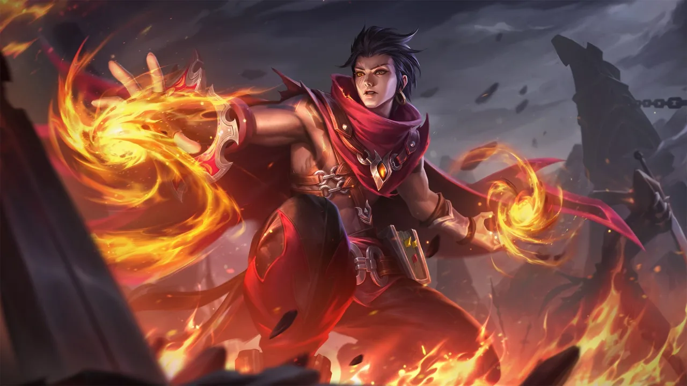

[Скины Валира](https://boostmlbb.ru/skins/valir.html)

[Скины](https://boostmlbb.ru/skins/)/[Валир](https://boostmlbb.ru/skins/valir.html)/Бледное пламя

[Скин Валира](https://boostmlbb.ru/skins/valir.html)

# Бледное пламя

Pale Flame

Обычный CommonВ продаже

Как получить

Продаётся в магазине обликов за 269 алмазов.

Цена

269 алмазов

Вышел

17 апреля 2018

## Что меняет облик

-   Бонус к характеристикам

## Все скины Валира [10](https://boostmlbb.ru/skins/valir.html)

[Кё КусанагиГрандиозный · 2024](https://boostmlbb.ru/skins/valir/kyo-kusanagi.html)[Феникс ИккиДелюкс · 2022](https://boostmlbb.ru/skins/valir/phoenix-ikki.html)[Лев ИккиГрандиозный · 2022](https://boostmlbb.ru/skins/valir/leo-ikki.html)[Призы­ватель сикигамиИсключительный · 2022](https://boostmlbb.ru/skins/valir/shikigami-sumonner.html)[Адское пламяВысший · 2022](https://boostmlbb.ru/skins/valir/infernal-blaze.html)[Повелитель демоновИзысканный · 2021](https://boostmlbb.ru/skins/valir/demonlord.html)[ДиктаторИсключительный · 2020](https://boostmlbb.ru/skins/valir/dictator.html)[Драконье пламяДелюкс · 2019](https://boostmlbb.ru/skins/valir/draconic-flame.html)[Искатель тайнОбычный · 2018](https://boostmlbb.ru/skins/valir/arcane-seeker.html)[Бледное пламяОбычный · 2018](https://boostmlbb.ru/skins/valir/pale-flame.html)

**Сколько стоит буст на герое Валир?**Выберите текущий и желаемый ранг. Стоимость появится на сайте.

[Рассчитать цену](https://boostmlbb.ru/order.html?type=hero)

## Частые вопросы

Как получить скин «Бледное пламя» на Валира?

Продаётся в магазине обликов за 269 алмазов.

Когда вышел скин «Бледное пламя»?

17 апреля 2018.

Какой класс у скина «Бледное пламя»?

Обычный (Common).
