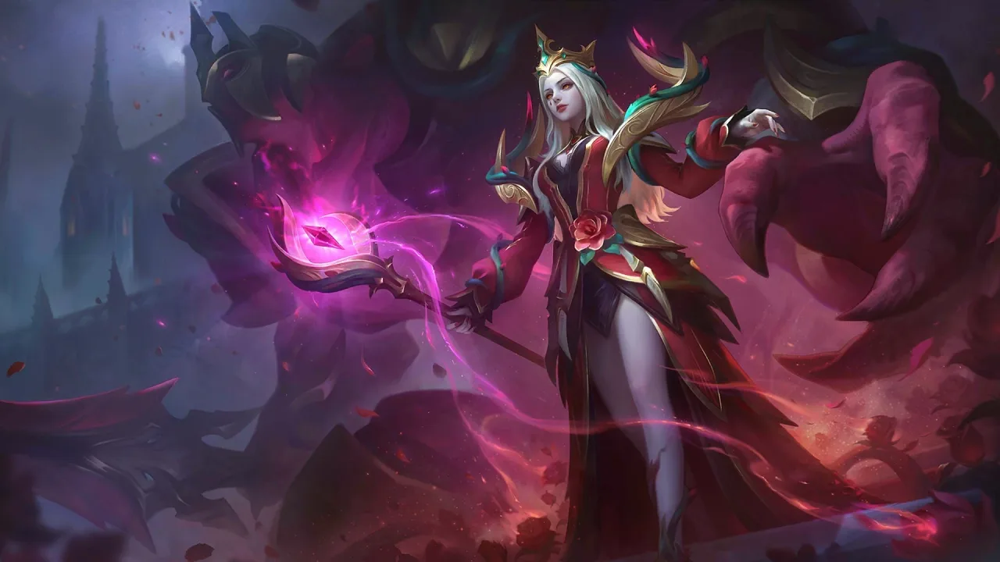

[Скины Вексаны](https://boostmlbb.ru/skins/vexana.html)

[Скины](https://boostmlbb.ru/skins/)/[Вексана](https://boostmlbb.ru/skins/vexana.html)/Кровавая роза

[Скин Вексаны](https://boostmlbb.ru/skins/vexana.html)

# Кровавая роза

Sanguine Rose

Делюкс DeluxeЭпическийОграниченный

Как получить

Выходил в магазине обликов во время события. Ограниченные облики иногда возвращаются в розыгрышах событий.

Вышел

29 июля 2018

## Что меняет облик

-   Новая внешность
-   Новые эффекты навыков
-   Звуки навыков
-   Анимация показа
-   Сцена показа
-   Бонус к характеристикам

## Все скины Вексаны [8](https://boostmlbb.ru/skins/vexana.html)

[Вечная клятваДелюкс · 2026](https://boostmlbb.ru/skins/vexana/eternal-vow.html)[Сумеречная звездаГрандиозный · 2025](https://boostmlbb.ru/skins/vexana/twilight-star.html)[Искажённая сказкаГрандиозный · 2024](https://boostmlbb.ru/skins/vexana/twisted-fairytale.html)[Солнечная импе­ратрицаИзысканный · 2023](https://boostmlbb.ru/skins/vexana/the-sun-empress.html)[Цирковая волшебницаИсключительный · 2022](https://boostmlbb.ru/skins/vexana/circus-magician.html)[Проклятые оковыОбычный · 2019](https://boostmlbb.ru/skins/vexana/cursed-shackle.html)[Кровавая розаДелюкс · 2018](https://boostmlbb.ru/skins/vexana/sanguine-rose.html)[Светлый маякОбычный · 2017](https://boostmlbb.ru/skins/vexana/lucent-beacon.html)

## Серия «Эпический»

[Надзи­ратель преис­поднейМинотавр · 2026](https://boostmlbb.ru/skins/minotaur/nether-overseer.html)[Затонувшее проклятиеАтлас · 2026](https://boostmlbb.ru/skins/atlas/sunken-curse.html)[Вечная клятваВексана · 2026](https://boostmlbb.ru/skins/vexana/eternal-vow.html)[Проклятый свитокХуфра · 2025](https://boostmlbb.ru/skins/khufra/cursed-scroll.html)[Охотница за душамиНаталья · 2025](https://boostmlbb.ru/skins/natalia/soul-huntress.html)[Граф кошмаровЛеоморд · 2025](https://boostmlbb.ru/skins/leomord/nightmare-count.html)[Вершитель звёздБелерик · 2025](https://boostmlbb.ru/skins/belerick/arbiter-of-stars.html)[Хранитель ветровВэйл · 2025](https://boostmlbb.ru/skins/vale/keeper-of-the-winds.html)

**Сколько стоит буст на герое Вексана?**Выберите текущий и желаемый ранг. Стоимость появится на сайте.

[Рассчитать цену](https://boostmlbb.ru/order.html?type=hero)

## Частые вопросы

Как получить скин «Кровавая роза» на Вексану?

Выходил в магазине обликов во время события. Ограниченные облики иногда возвращаются в розыгрышах событий.

Когда вышел скин «Кровавая роза»?

29 июля 2018.

Какой класс у скина «Кровавая роза»?

Делюкс (Deluxe), серия «Эпический».
