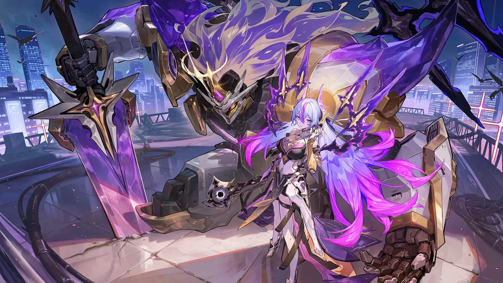

[Скины Вексаны](https://boostmlbb.ru/skins/vexana.html)

[Скины](https://boostmlbb.ru/skins/)/[Вексана](https://boostmlbb.ru/skins/vexana.html)/Сумеречная звезда

[Скин Вексаны](https://boostmlbb.ru/skins/vexana.html)

# Сумеречная звезда

Twilight Star

Грандиозный GrandПретендентыОграниченный

Как получить

Выходил в событии «Претенденты». Ограниченные облики иногда возвращаются в розыгрышах событий.

Вышел

3 октября 2025

## Что меняет облик

-   Новая внешность
-   Новые эффекты навыков
-   Звуки навыков
-   Своя озвучка
-   Иконки навыков
-   Анимация показа
-   Сцена показа
-   Музыка показа
-   Анимация появления
-   Особые действия
-   Бонус к характеристикам

## Все скины Вексаны [8](https://boostmlbb.ru/skins/vexana.html)

[Вечная клятваДелюкс · 2026](https://boostmlbb.ru/skins/vexana/eternal-vow.html)[Сумеречная звездаГрандиозный · 2025](https://boostmlbb.ru/skins/vexana/twilight-star.html)[Искажённая сказкаГрандиозный · 2024](https://boostmlbb.ru/skins/vexana/twisted-fairytale.html)[Солнечная импе­ратрицаИзысканный · 2023](https://boostmlbb.ru/skins/vexana/the-sun-empress.html)[Цирковая волшебницаИсключительный · 2022](https://boostmlbb.ru/skins/vexana/circus-magician.html)[Проклятые оковыОбычный · 2019](https://boostmlbb.ru/skins/vexana/cursed-shackle.html)[Кровавая розаДелюкс · 2018](https://boostmlbb.ru/skins/vexana/sanguine-rose.html)[Светлый маякОбычный · 2017](https://boostmlbb.ru/skins/vexana/lucent-beacon.html)

## Серия «Претенденты»

[Райко Серебряная МолнияСелена · 2026](https://boostmlbb.ru/skins/selena/silverbolt-raiko.html)[Импе­ратрица АрасиОбсидия · 2026](https://boostmlbb.ru/skins/obsidia/imperatrix-arashi.html)[Сияние рассветаГвиневра · 2025](https://boostmlbb.ru/skins/guinevere/daybreak-halo.html)[Техни­ческий генийЧан'Э · 2024](https://boostmlbb.ru/skins/change/tech-tensai.html)[Меткий призракЛесли · 2024](https://boostmlbb.ru/skins/lesley/deadeye-spectre.html)[Меха-деваРуби · 2023](https://boostmlbb.ru/skins/ruby/mecha-maiden.html)[Клинок надеждыФанни · 2022](https://boostmlbb.ru/skins/fanny/blade-of-kibou.html)[Мисс ХикариЛейла · 2022](https://boostmlbb.ru/skins/layla/miss-hikari.html)

**Сколько стоит буст на герое Вексана?**Выберите текущий и желаемый ранг. Стоимость появится на сайте.

[Рассчитать цену](https://boostmlbb.ru/order.html?type=hero)

## Частые вопросы

Как получить скин «Сумеречная звезда» на Вексану?

Выходил в событии «Претенденты». Ограниченные облики иногда возвращаются в розыгрышах событий.

Когда вышел скин «Сумеречная звезда»?

3 октября 2025.

Какой класс у скина «Сумеречная звезда»?

Грандиозный (Grand), серия «Претенденты».
