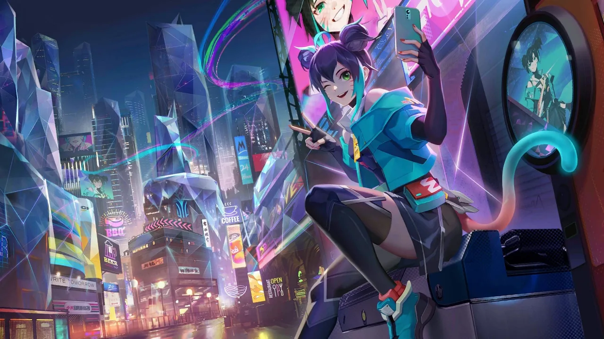

[Тир-лист](https://boostmlbb.ru/heroes/)[Предметы](https://boostmlbb.ru/items/)[Скины](https://boostmlbb.ru/skins/)[Новости и гайды](https://boostmlbb.ru/news/)

[Скины](https://boostmlbb.ru/skins/)/[Ванван](https://boostmlbb.ru/skins/wanwan.html)/Ванван M-World

[Скин Ванван](https://boostmlbb.ru/skins/wanwan.html)

# Ванван M-World

M-World Wanwan

Делюкс DeluxeM-WorldОграниченный

Как получить

Выходил в событии «M-World». Ограниченные облики иногда возвращаются в розыгрышах событий.

Вышел

16 апреля 2022

## Что меняет облик

-   Новая внешность
-   Новые эффекты навыков
-   Звуки навыков
-   Анимация показа
-   Сцена показа
-   Музыка показа
-   Бонус к характеристикам

## Все скины Ванван [8](https://boostmlbb.ru/skins/wanwan.html)

[Летние брызгиИсключительный · 2025](https://boostmlbb.ru/skins/wanwan/summer-splash.html)[Летящая ласточкаГрандиозный · 2024](https://boostmlbb.ru/skins/wanwan/flying-swallow.html)[Ванван M-WorldДелюкс · 2022](https://boostmlbb.ru/skins/wanwan/m-world-wanwan.html)[Е-гёрлИсключительный · 2021](https://boostmlbb.ru/skins/wanwan/e-girl.html)[Пиксельный взрывИзысканный · 2021](https://boostmlbb.ru/skins/wanwan/pixel-blast.html)[Подростко­вый попИсключительный · 2020](https://boostmlbb.ru/skins/wanwan/teen-pop.html)[Командир сёдзёОбычный · 2020](https://boostmlbb.ru/skins/wanwan/shoujo-commander.html)[Мелькающая звездаОбычный · 2019](https://boostmlbb.ru/skins/wanwan/darting-star.html)

## Серия «M-World»

[Инь M-WorldИнь · 2022](https://boostmlbb.ru/skins/yin/m-world-yin.html)[Линг M-WorldЛинг · 2022](https://boostmlbb.ru/skins/ling/m-world-ling.html)

**Поднимем ранг на герое Ванван**Цена считается в калькуляторе

[Рассчитать цену](https://boostmlbb.ru/order.html?type=hero)

## Частые вопросы

Как получить скин «Ванван M-World» на Ванван?

Выходил в событии «M-World». Ограниченные облики иногда возвращаются в розыгрышах событий.

Когда вышел скин «Ванван M-World»?

16 апреля 2022.

Какой класс у скина «Ванван M-World»?

Делюкс (Deluxe), серия «M-World».
