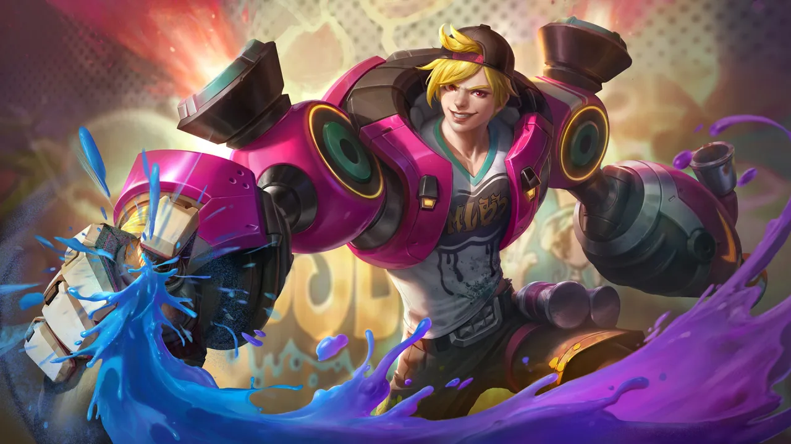
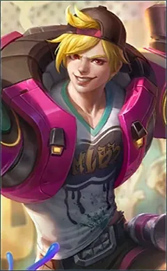

[Скины Икс.Борга](https://boostmlbb.ru/skins/x-borg.html)

[Скины](https://boostmlbb.ru/skins/)/[Икс.Борг](https://boostmlbb.ru/skins/x-borg.html)/Граффити-мода

[Скин Икс.Борга](https://boostmlbb.ru/skins/x-borg.html)

# Граффити-мода

Graffiti Fashion

Исключительный ExceptionalЗвёздный участникОграниченный

Как получить

Награда «Звёздного участника» в июне 2020.

Вышел

1 июня 2020

## Что меняет облик

-   Новая внешность
-   Новые эффекты навыков
-   Анимация показа
-   Бонус к характеристикам

## Все скины Икс.Борга [6](https://boostmlbb.ru/skins/x-borg.html)

[БамблбиГрандиозный · 2025](https://boostmlbb.ru/skins/x-borg/bumblebee.html)[Бунтарь ПекадосОбычный · 2025](https://boostmlbb.ru/skins/x-borg/pecados-rioter.html)[Мотод­рифтерОбычный · 2023](https://boostmlbb.ru/skins/x-borg/moto-drifter.html)[Маньяк ТеслыГрандиозный · 2020](https://boostmlbb.ru/skins/x-borg/tesla-maniac.html)[Граффити-модаИсключительный · 2020](https://boostmlbb.ru/skins/x-borg/graffiti-fashion.html)[Синяя буряОбычный · 2019](https://boostmlbb.ru/skins/x-borg/blue-storm.html)

## Серия «Звёздный участник»

[Морячка, рождённая приливомКалеа · 2026](https://boostmlbb.ru/skins/kalea/tideborn-sailor.html)[Тень кицунэХаябуса · 2026](https://boostmlbb.ru/skins/hayabusa/kitsune-s-shadow.html)[Клыки резниХанзо · 2026](https://boostmlbb.ru/skins/hanzo/fangs-of-slaughter.html)[Тлеющая крепостьБелерик · 2026](https://boostmlbb.ru/skins/belerick/smouldering-fortress.html)[Магитех­нический призракОбсидия · 2026](https://boostmlbb.ru/skins/obsidia/magitech-wraith.html)[Элизийское сияниеЦзэтянь · 2026](https://boostmlbb.ru/skins/zetian/elysian-luminance.html)[Батальон стражейХильда · 2026](https://boostmlbb.ru/skins/hilda/guardian-battalion.html)[Мечта­тельный коиХарли · 2026](https://boostmlbb.ru/skins/harley/dreaming-koi.html)

**Сколько стоит буст на герое Икс.Борг?**Выберите текущий и желаемый ранг. Стоимость появится на сайте.

[Рассчитать цену](https://boostmlbb.ru/order.html?type=hero)

## Частые вопросы

Как получить скин «Граффити-мода» на Икс.Борга?

Награда «Звёздного участника» в июне 2020.

Когда вышел скин «Граффити-мода»?

1 июня 2020.

Какой класс у скина «Граффити-мода»?

Исключительный (Exceptional), серия «Звёздный участник».
