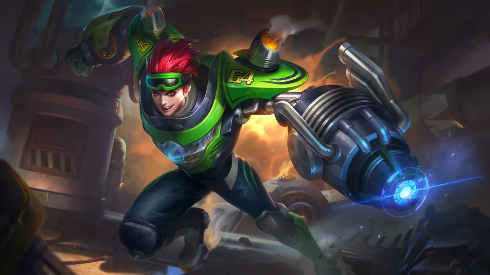

[Скины Икс.Борга](https://boostmlbb.ru/skins/x-borg.html)

[Скины](https://boostmlbb.ru/skins/)/[Икс.Борг](https://boostmlbb.ru/skins/x-borg.html)/Мотодрифтер

[Скин Икс.Борга](https://boostmlbb.ru/skins/x-borg.html)

# Мотодрифтер

Moto Drifter

Обычный CommonЭлитныйВ продаже

Как получить

Продаётся в магазине обликов за 599 алмазов.

Цена

599 алмазов

Вышел

18 февраля 2023

## Что меняет облик

-   Новая внешность
-   Другой цвет эффектов
-   Анимация показа
-   Бонус к характеристикам

## Все скины Икс.Борга [6](https://boostmlbb.ru/skins/x-borg.html)

[БамблбиГрандиозный · 2025](https://boostmlbb.ru/skins/x-borg/bumblebee.html)[Бунтарь ПекадосОбычный · 2025](https://boostmlbb.ru/skins/x-borg/pecados-rioter.html)[Мотод­рифтерОбычный · 2023](https://boostmlbb.ru/skins/x-borg/moto-drifter.html)[Маньяк ТеслыГрандиозный · 2020](https://boostmlbb.ru/skins/x-borg/tesla-maniac.html)[Граффити-модаИсключительный · 2020](https://boostmlbb.ru/skins/x-borg/graffiti-fashion.html)[Синяя буряОбычный · 2019](https://boostmlbb.ru/skins/x-borg/blue-storm.html)

## Серия «Элитный»

[Золотой османтусЧан'Э · 2026](https://boostmlbb.ru/skins/change/golden-osmanthus.html)[Король-воена­чальникМартис · 2025](https://boostmlbb.ru/skins/martis/warlord-king.html)[Кадет открытого моряКимми · 2024](https://boostmlbb.ru/skins/kimmy/high-seas-cadet.html)[Зелёная копейщицаСильвана · 2024](https://boostmlbb.ru/skins/silvanna/verdant-lancer.html)[Мародёр Кровавое КопытоХилос · 2024](https://boostmlbb.ru/skins/hylos/bloodhoof-marauder.html)[Изящная бабочкаГвиневра · 2024](https://boostmlbb.ru/skins/guinevere/elegant-butterfly.html)[Маркиз клинковЛанселот · 2024](https://boostmlbb.ru/skins/lancelot/marques-of-blades.html)[Привал в пустошахЧип · 2024](https://boostmlbb.ru/skins/chip/badlands-hiatus.html)

**Сколько стоит буст на герое Икс.Борг?**Выберите текущий и желаемый ранг. Стоимость появится на сайте.

[Рассчитать цену](https://boostmlbb.ru/order.html?type=hero)

## Частые вопросы

Как получить скин «Мотодрифтер» на Икс.Борга?

Продаётся в магазине обликов за 599 алмазов.

Когда вышел скин «Мотодрифтер»?

18 февраля 2023.

Какой класс у скина «Мотодрифтер»?

Обычный (Common), серия «Элитный».
