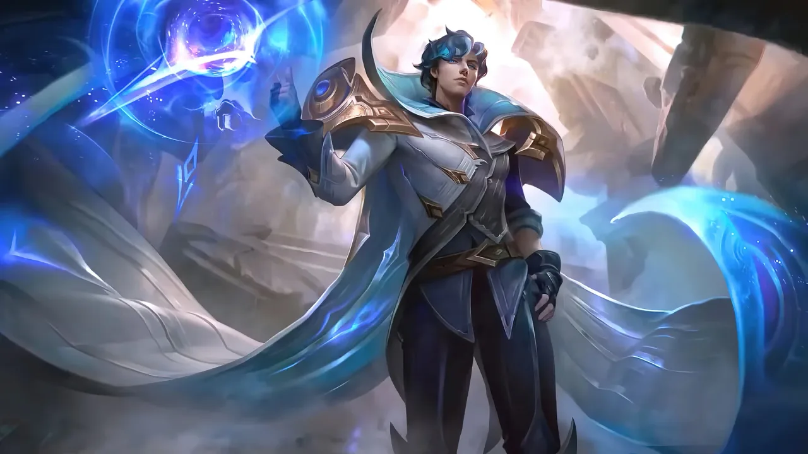

[Тир-лист](https://boostmlbb.ru/heroes/)[Предметы](https://boostmlbb.ru/items/)[Скины](https://boostmlbb.ru/skins/)[Новости и гайды](https://boostmlbb.ru/news/)

[Скины](https://boostmlbb.ru/skins/)/Ксавьер

# Скины Ксавьера

Скинов

5

Можно купить

1

Последний

[Монарх, рождённый солнцем](https://boostmlbb.ru/skins/xavier/sunborn-monarch.html)2026

[Профиль героя→](https://boostmlbb.ru/heroes/xavier.html)

## Все скины

[Монарх, рождённый солнцем2026](https://boostmlbb.ru/skins/xavier/sunborn-monarch.html)[Ксавьер «За облаками»Изысканный · 2024](https://boostmlbb.ru/skins/xavier/beyond-the-clouds-xavier.html)[Мастер твёрдого светаИсключительный · 2024](https://boostmlbb.ru/skins/xavier/hardlight-artificer.html)[Сатору ГоджоГрандиозный · 2023](https://boostmlbb.ru/skins/xavier/satoru-gojo.html)[Вердикт светаОбычный · 2022](https://boostmlbb.ru/skins/xavier/verdict-of-light.html)

**Поднимем ранг на герое Ксавьер**Цена считается в калькуляторе

[Рассчитать цену](https://boostmlbb.ru/order.html?type=hero)

## Частые вопросы

Сколько скинов у Ксавьера?

5 скинов без стандартного облика. Последний — «Монарх, рождённый солнцем» (Sunborn Monarch), январь 2026.

Какие скины Ксавьера можно купить сейчас?

«Вердикт света» (269 алмазов). Остальные облики ограниченные и возвращаются только в событиях.

Какой самый редкий скин Ксавьера?

«Сатору Годжо» (Satoru Gojo), класс грандиозный, серия «Магическая битва». Выходил в событии коллаборации MLBB × Jujutsu Kaisen.
