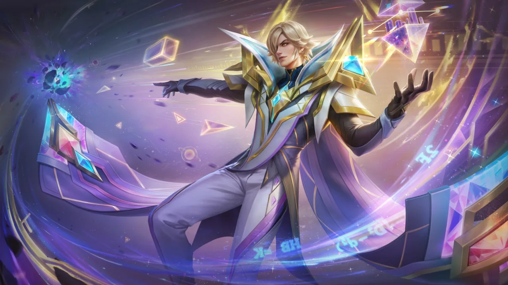

[Скины Ксавьера](https://boostmlbb.ru/skins/xavier.html)

[Скины](https://boostmlbb.ru/skins/)/[Ксавьер](https://boostmlbb.ru/skins/xavier.html)/Мастер твёрдого света

[Скин Ксавьера](https://boostmlbb.ru/skins/xavier.html)

# Мастер твёрдого света

Hardlight Artificer

Исключительный ExceptionalЗвёздный участникОграниченный

Как получить

Награда «Звёздного участника» в декабре 2024.

Вышел

1 декабря 2024

## Что меняет облик

-   Новая внешность
-   Новые эффекты навыков
-   Анимация показа
-   Сцена показа
-   Бонус к характеристикам

## Все скины Ксавьера [5](https://boostmlbb.ru/skins/xavier.html)

[Монарх, рождённый солнцем2026](https://boostmlbb.ru/skins/xavier/sunborn-monarch.html)[Ксавьер «За облаками»Изысканный · 2024](https://boostmlbb.ru/skins/xavier/beyond-the-clouds-xavier.html)[Мастер твёрдого светаИсключительный · 2024](https://boostmlbb.ru/skins/xavier/hardlight-artificer.html)[Сатору ГоджоГрандиозный · 2023](https://boostmlbb.ru/skins/xavier/satoru-gojo.html)[Вердикт светаОбычный · 2022](https://boostmlbb.ru/skins/xavier/verdict-of-light.html)

## Серия «Звёздный участник»

[Морячка, рождённая приливомКалеа · 2026](https://boostmlbb.ru/skins/kalea/tideborn-sailor.html)[Тень кицунэХаябуса · 2026](https://boostmlbb.ru/skins/hayabusa/kitsune-s-shadow.html)[Клыки резниХанзо · 2026](https://boostmlbb.ru/skins/hanzo/fangs-of-slaughter.html)[Тлеющая крепостьБелерик · 2026](https://boostmlbb.ru/skins/belerick/smouldering-fortress.html)[Магитех­нический призракОбсидия · 2026](https://boostmlbb.ru/skins/obsidia/magitech-wraith.html)[Элизийское сияниеЦзэтянь · 2026](https://boostmlbb.ru/skins/zetian/elysian-luminance.html)[Батальон стражейХильда · 2026](https://boostmlbb.ru/skins/hilda/guardian-battalion.html)[Мечта­тельный коиХарли · 2026](https://boostmlbb.ru/skins/harley/dreaming-koi.html)

**Сколько стоит буст на герое Ксавьер?**Выберите текущий и желаемый ранг. Стоимость появится на сайте.

[Рассчитать цену](https://boostmlbb.ru/order.html?type=hero)

## Частые вопросы

Как получить скин «Мастер твёрдого света» на Ксавьера?

Награда «Звёздного участника» в декабре 2024.

Когда вышел скин «Мастер твёрдого света»?

1 декабря 2024.

Какой класс у скина «Мастер твёрдого света»?

Исключительный (Exceptional), серия «Звёздный участник».
