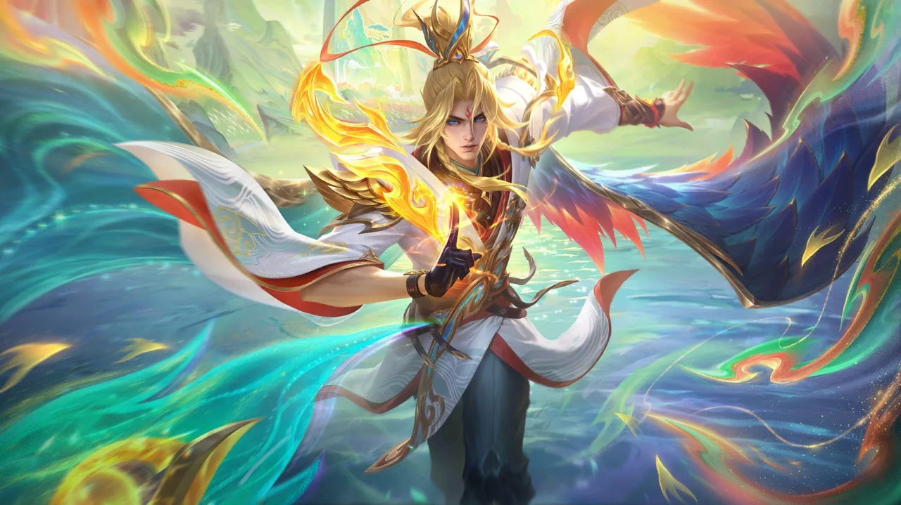

[Скины Ксавьера](https://boostmlbb.ru/skins/xavier.html)

[Скины](https://boostmlbb.ru/skins/)/[Ксавьер](https://boostmlbb.ru/skins/xavier.html)/Монарх, рождённый солнцем

[Скин Ксавьера](https://boostmlbb.ru/skins/xavier.html)

# Монарх, рождённый солнцем

Sunborn Monarch

Коллекционный

Как получить

Главный приз розыгрыша в коллекционном событии, попытки покупаются за алмазы. Ограниченные облики иногда возвращаются в розыгрышах событий.

Вышел

январь 2026

## Все скины Ксавьера [5](https://boostmlbb.ru/skins/xavier.html)

[Монарх, рождённый солнцем2026](https://boostmlbb.ru/skins/xavier/sunborn-monarch.html)[Ксавьер «За облаками»Изысканный · 2024](https://boostmlbb.ru/skins/xavier/beyond-the-clouds-xavier.html)[Мастер твёрдого светаИсключительный · 2024](https://boostmlbb.ru/skins/xavier/hardlight-artificer.html)[Сатору ГоджоГрандиозный · 2023](https://boostmlbb.ru/skins/xavier/satoru-gojo.html)[Вердикт светаОбычный · 2022](https://boostmlbb.ru/skins/xavier/verdict-of-light.html)

## Серия «Коллекционный»

[ОчистительБруно · 2026](https://boostmlbb.ru/skins/bruno/the-purifier.html)[Небесный бунтарьСан · 2026](https://boostmlbb.ru/skins/sun/celestial-rebel.html)[Кайдзю глубинХелкарт · 2026](https://boostmlbb.ru/skins/helcurt/kaiju-of-the-deep.html)[Звёздный дозорныйКимми · 2026](https://boostmlbb.ru/skins/kimmy/starbound-sentry.html)[Монархиня грёзАлиса · 2026](https://boostmlbb.ru/skins/alice/dreaming-monarch.html)[Дрожь глубинГрок · 2026](https://boostmlbb.ru/skins/grock/tremor-of-the-deep.html)[Небесный генералТигрил · 2026](https://boostmlbb.ru/skins/tigreal/celestial-general.html)[Похититель душЭймон · 2025](https://boostmlbb.ru/skins/aamon/soul-reaver.html)

**Сколько стоит буст на герое Ксавьер?**Выберите текущий и желаемый ранг. Стоимость появится на сайте.

[Рассчитать цену](https://boostmlbb.ru/order.html?type=hero)

## Частые вопросы

Как получить скин «Монарх, рождённый солнцем» на Ксавьера?

Главный приз розыгрыша в коллекционном событии, попытки покупаются за алмазы. Ограниченные облики иногда возвращаются в розыгрышах событий.

Когда вышел скин «Монарх, рождённый солнцем»?

Январь 2026.
