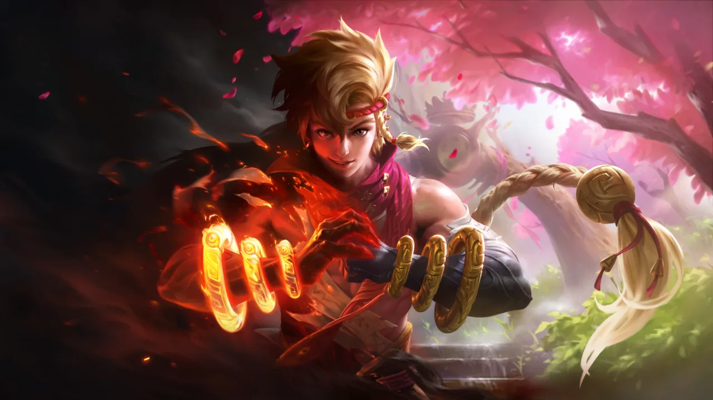

[Тир-лист](https://boostmlbb.ru/heroes/)[Предметы](https://boostmlbb.ru/items/)[Скины](https://boostmlbb.ru/skins/)[Новости и гайды](https://boostmlbb.ru/news/)

[Скины](https://boostmlbb.ru/skins/)/Инь

# Скины Иня

Скинов

5

Можно купить

1

Последний

[Вечный страж](https://boostmlbb.ru/skins/yin/eternal-guardian.html)2023

[Профиль героя→](https://boostmlbb.ru/heroes/yin.html)

## Все скины

[Вечный стражИсключительный · 2023](https://boostmlbb.ru/skins/yin/eternal-guardian.html)[ЭренГрандиозный · 2023](https://boostmlbb.ru/skins/yin/eren.html)[Юдзи ИтадориГрандиозный · 2023](https://boostmlbb.ru/skins/yin/yuji-itadori.html)[Инь M-WorldДелюкс · 2022](https://boostmlbb.ru/skins/yin/m-world-yin.html)[Кулаки доблестиОбычный · 2022](https://boostmlbb.ru/skins/yin/fists-of-valor.html)

**Поднимем ранг на герое Инь**Цена считается в калькуляторе

[Рассчитать цену](https://boostmlbb.ru/order.html?type=hero)

## Частые вопросы

Сколько скинов у Иня?

5 скинов без стандартного облика. Последний — «Вечный страж» (Eternal Guardian), 1 августа 2023.

Какие скины Иня можно купить сейчас?

«Кулаки доблести» (269 алмазов). Остальные облики ограниченные и возвращаются только в событиях.

Какой самый редкий скин Иня?

«Эрен» (Eren), класс грандиозный, серия «Атака титанов». Выходил в событии коллаборации MLBB × Attack on Titan.
