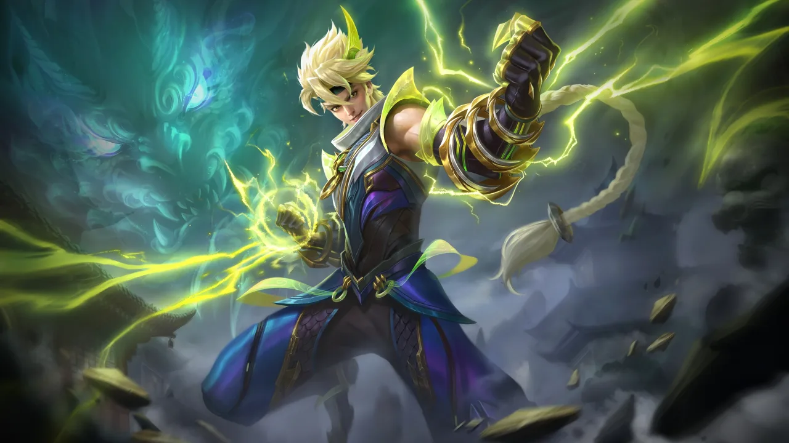

[Скины Иня](https://boostmlbb.ru/skins/yin.html)

[Скины](https://boostmlbb.ru/skins/)/[Инь](https://boostmlbb.ru/skins/yin.html)/Вечный страж

[Скин Иня](https://boostmlbb.ru/skins/yin.html)

# Вечный страж

Eternal Guardian

Исключительный ExceptionalЗвёздный участникОграниченный

Как получить

Награда «Звёздного участника» в августе 2023.

Вышел

1 августа 2023

## Что меняет облик

-   Новая внешность
-   Новые эффекты навыков
-   Анимация показа
-   Сцена показа
-   Бонус к характеристикам

## Все скины Иня [5](https://boostmlbb.ru/skins/yin.html)

[Вечный стражИсключительный · 2023](https://boostmlbb.ru/skins/yin/eternal-guardian.html)[ЭренГрандиозный · 2023](https://boostmlbb.ru/skins/yin/eren.html)[Юдзи ИтадориГрандиозный · 2023](https://boostmlbb.ru/skins/yin/yuji-itadori.html)[Инь M-WorldДелюкс · 2022](https://boostmlbb.ru/skins/yin/m-world-yin.html)[Кулаки доблестиОбычный · 2022](https://boostmlbb.ru/skins/yin/fists-of-valor.html)

## Серия «Звёздный участник»

[Морячка, рождённая приливомКалеа · 2026](https://boostmlbb.ru/skins/kalea/tideborn-sailor.html)[Тень кицунэХаябуса · 2026](https://boostmlbb.ru/skins/hayabusa/kitsune-s-shadow.html)[Клыки резниХанзо · 2026](https://boostmlbb.ru/skins/hanzo/fangs-of-slaughter.html)[Тлеющая крепостьБелерик · 2026](https://boostmlbb.ru/skins/belerick/smouldering-fortress.html)[Магитех­нический призракОбсидия · 2026](https://boostmlbb.ru/skins/obsidia/magitech-wraith.html)[Элизийское сияниеЦзэтянь · 2026](https://boostmlbb.ru/skins/zetian/elysian-luminance.html)[Батальон стражейХильда · 2026](https://boostmlbb.ru/skins/hilda/guardian-battalion.html)[Мечта­тельный коиХарли · 2026](https://boostmlbb.ru/skins/harley/dreaming-koi.html)

**Сколько стоит буст на герое Инь?**Выберите текущий и желаемый ранг. Стоимость появится на сайте.

[Рассчитать цену](https://boostmlbb.ru/order.html?type=hero)

## Частые вопросы

Как получить скин «Вечный страж» на Иня?

Награда «Звёздного участника» в августе 2023.

Когда вышел скин «Вечный страж»?

1 августа 2023.

Какой класс у скина «Вечный страж»?

Исключительный (Exceptional), серия «Звёздный участник».
