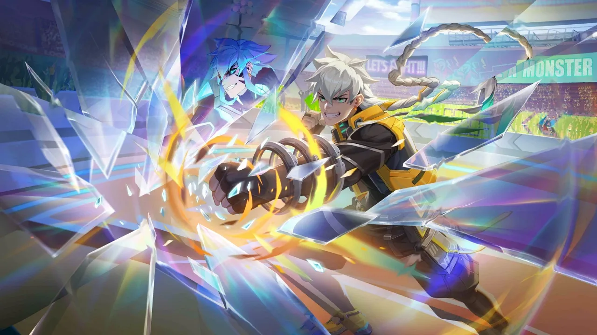

[Скины Иня](https://boostmlbb.ru/skins/yin.html)

[Скины](https://boostmlbb.ru/skins/)/[Инь](https://boostmlbb.ru/skins/yin.html)/Инь M-World

[Скин Иня](https://boostmlbb.ru/skins/yin.html)

# Инь M-World

M-World Yin

Делюкс DeluxeM-WorldОграниченный

Как получить

Выходил в событии «M-World». Ограниченные облики иногда возвращаются в розыгрышах событий.

Вышел

30 апреля 2022

## Что меняет облик

-   Новая внешность
-   Новые эффекты навыков
-   Звуки навыков
-   Своя озвучка
-   Анимация показа
-   Сцена показа
-   Бонус к характеристикам

## Все скины Иня [5](https://boostmlbb.ru/skins/yin.html)

[Вечный стражИсключительный · 2023](https://boostmlbb.ru/skins/yin/eternal-guardian.html)[ЭренГрандиозный · 2023](https://boostmlbb.ru/skins/yin/eren.html)[Юдзи ИтадориГрандиозный · 2023](https://boostmlbb.ru/skins/yin/yuji-itadori.html)[Инь M-WorldДелюкс · 2022](https://boostmlbb.ru/skins/yin/m-world-yin.html)[Кулаки доблестиОбычный · 2022](https://boostmlbb.ru/skins/yin/fists-of-valor.html)

## Серия «M-World»

[Линг M-WorldЛинг · 2022](https://boostmlbb.ru/skins/ling/m-world-ling.html)[Ванван M-WorldВанван · 2022](https://boostmlbb.ru/skins/wanwan/m-world-wanwan.html)

**Сколько стоит буст на герое Инь?**Выберите текущий и желаемый ранг. Стоимость появится на сайте.

[Рассчитать цену](https://boostmlbb.ru/order.html?type=hero)

## Частые вопросы

Как получить скин «Инь M-World» на Иня?

Выходил в событии «M-World». Ограниченные облики иногда возвращаются в розыгрышах событий.

Когда вышел скин «Инь M-World»?

30 апреля 2022.

Какой класс у скина «Инь M-World»?

Делюкс (Deluxe), серия «M-World».
