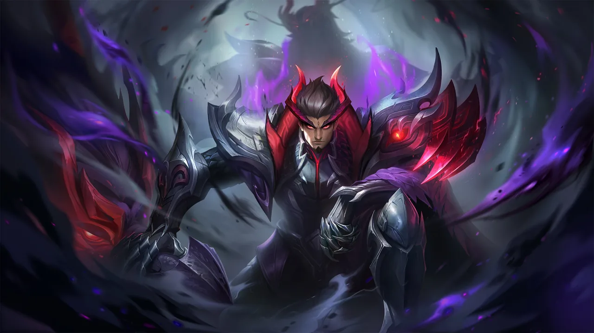

[Тир-лист](https://boostmlbb.ru/heroes/)[Предметы](https://boostmlbb.ru/items/)[Скины](https://boostmlbb.ru/skins/)[Новости и гайды](https://boostmlbb.ru/news/)

[Скины](https://boostmlbb.ru/skins/)/Чонг

# Скины Чонга

Скинов

6

Можно купить

1

Последний

[Косми­ческий дракон](https://boostmlbb.ru/skins/yu-zhong/cosmic-dragon.html)2023

[Профиль героя→](https://boostmlbb.ru/heroes/yu-zhong.html)

## Все скины

[Косми­ческий драконГрандиозный · 2023](https://boostmlbb.ru/skins/yu-zhong/cosmic-dragon.html)[Тень драконаДелюкс · 2023](https://boostmlbb.ru/skins/yu-zhong/dragon-s-shade.html)[Экзорцист ЧонгГрандиозный · 2022](https://boostmlbb.ru/skins/yu-zhong/exorcist-yu-zhong.html)[Кровавый змейИзысканный · 2021](https://boostmlbb.ru/skins/yu-zhong/blood-serpent.html)[БиоугрозаИсключительный · 2020](https://boostmlbb.ru/skins/yu-zhong/biohazard.html)[Изумрудный драконОбычный · 2020](https://boostmlbb.ru/skins/yu-zhong/emerald-dragon.html)

**Поднимем ранг на герое Чонг**Цена считается в калькуляторе

[Рассчитать цену](https://boostmlbb.ru/order.html?type=hero)

## Частые вопросы

Сколько скинов у Чонга?

6 скинов без стандартного облика. Последний — «Космический дракон» (Cosmic Dragon), 20 ноября 2023.

Какие скины Чонга можно купить сейчас?

«Изумрудный дракон» (269 алмазов). Остальные облики ограниченные и возвращаются только в событиях.

Какой самый редкий скин Чонга?

«Космический дракон» (Cosmic Dragon), класс грандиозный, серия «PRIME». Награда пропуска M5.
