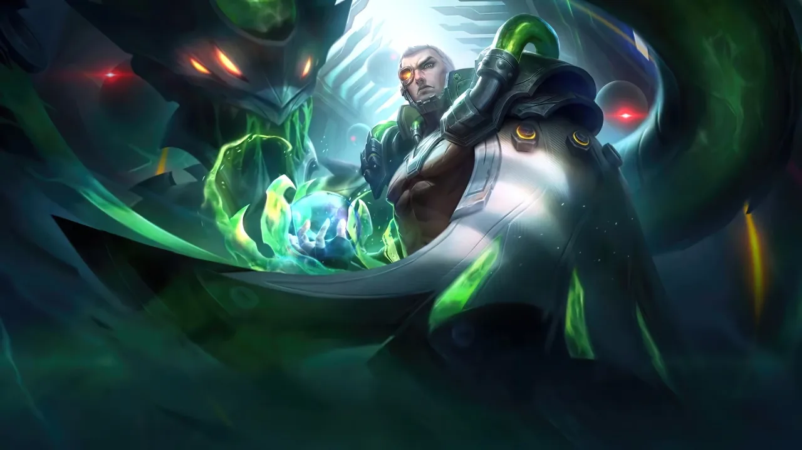
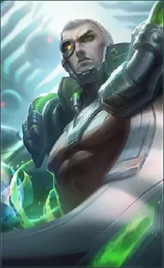

[Скины Чонга](https://boostmlbb.ru/skins/yu-zhong.html)

[Скины](https://boostmlbb.ru/skins/)/[Чонг](https://boostmlbb.ru/skins/yu-zhong.html)/Биоугроза

[Скин Чонга](https://boostmlbb.ru/skins/yu-zhong.html)

# Биоугроза

Biohazard

Исключительный ExceptionalЗвёздный участникОграниченный

Как получить

Награда «Звёздного участника» в декабре 2020.

Вышел

1 декабря 2020

## Что меняет облик

-   Новая внешность
-   Новые эффекты навыков
-   Анимация показа
-   Бонус к характеристикам

## Все скины Чонга [6](https://boostmlbb.ru/skins/yu-zhong.html)

[Косми­ческий драконГрандиозный · 2023](https://boostmlbb.ru/skins/yu-zhong/cosmic-dragon.html)[Тень драконаДелюкс · 2023](https://boostmlbb.ru/skins/yu-zhong/dragon-s-shade.html)[Экзорцист ЧонгГрандиозный · 2022](https://boostmlbb.ru/skins/yu-zhong/exorcist-yu-zhong.html)[Кровавый змейИзысканный · 2021](https://boostmlbb.ru/skins/yu-zhong/blood-serpent.html)[БиоугрозаИсключительный · 2020](https://boostmlbb.ru/skins/yu-zhong/biohazard.html)[Изумрудный драконОбычный · 2020](https://boostmlbb.ru/skins/yu-zhong/emerald-dragon.html)

## Серия «Звёздный участник»

[Морячка, рождённая приливомКалеа · 2026](https://boostmlbb.ru/skins/kalea/tideborn-sailor.html)[Тень кицунэХаябуса · 2026](https://boostmlbb.ru/skins/hayabusa/kitsune-s-shadow.html)[Клыки резниХанзо · 2026](https://boostmlbb.ru/skins/hanzo/fangs-of-slaughter.html)[Тлеющая крепостьБелерик · 2026](https://boostmlbb.ru/skins/belerick/smouldering-fortress.html)[Магитех­нический призракОбсидия · 2026](https://boostmlbb.ru/skins/obsidia/magitech-wraith.html)[Элизийское сияниеЦзэтянь · 2026](https://boostmlbb.ru/skins/zetian/elysian-luminance.html)[Батальон стражейХильда · 2026](https://boostmlbb.ru/skins/hilda/guardian-battalion.html)[Мечта­тельный коиХарли · 2026](https://boostmlbb.ru/skins/harley/dreaming-koi.html)

**Сколько стоит буст на герое Чонг?**Выберите текущий и желаемый ранг. Стоимость появится на сайте.

[Рассчитать цену](https://boostmlbb.ru/order.html?type=hero)

## Частые вопросы

Как получить скин «Биоугроза» на Чонга?

Награда «Звёздного участника» в декабре 2020.

Когда вышел скин «Биоугроза»?

1 декабря 2020.

Какой класс у скина «Биоугроза»?

Исключительный (Exceptional), серия «Звёздный участник».
