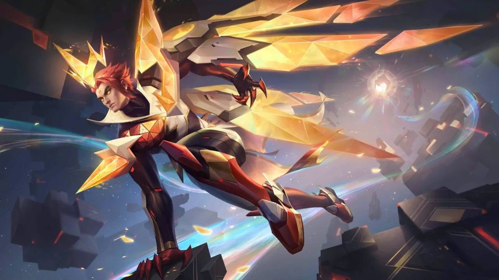

[Тир-лист](https://boostmlbb.ru/heroes/)[Предметы](https://boostmlbb.ru/items/)[Скины](https://boostmlbb.ru/skins/)[Новости и гайды](https://boostmlbb.ru/news/)

[Скины](https://boostmlbb.ru/skins/)/[Чонг](https://boostmlbb.ru/skins/yu-zhong.html)/Космический дракон

[Скин Чонга](https://boostmlbb.ru/skins/yu-zhong.html)

# Космический дракон

Cosmic Dragon

Грандиозный GrandPRIMEОграниченный

Как получить

Награда пропуска M5.

Вышел

20 ноября 2023

## Что меняет облик

-   Новая внешность
-   Новые эффекты навыков
-   Звуки навыков
-   Своя озвучка
-   Анимация показа
-   Сцена показа
-   Музыка показа
-   Анимация появления
-   Особые действия
-   Бонус к характеристикам

## Все скины Чонга [6](https://boostmlbb.ru/skins/yu-zhong.html)

[Косми­ческий драконГрандиозный · 2023](https://boostmlbb.ru/skins/yu-zhong/cosmic-dragon.html)[Тень драконаДелюкс · 2023](https://boostmlbb.ru/skins/yu-zhong/dragon-s-shade.html)[Экзорцист ЧонгГрандиозный · 2022](https://boostmlbb.ru/skins/yu-zhong/exorcist-yu-zhong.html)[Кровавый змейИзысканный · 2021](https://boostmlbb.ru/skins/yu-zhong/blood-serpent.html)[БиоугрозаИсключительный · 2020](https://boostmlbb.ru/skins/yu-zhong/biohazard.html)[Изумрудный драконОбычный · 2020](https://boostmlbb.ru/skins/yu-zhong/emerald-dragon.html)

## Серия «PRIME»

[Косми­ческое пламяКлауд · 2024](https://boostmlbb.ru/skins/claude/cosmic-blaze.html)[Звёздный блескБеатрис · 2022](https://boostmlbb.ru/skins/beatrix/stellar-briliance.html)[Охотник на нечистьРоджер · 2021](https://boostmlbb.ru/skins/roger/fiend-hunter.html)[Косми­ческий финалГрейнджер](https://boostmlbb.ru/skins/granger/cosmic-finality.html)

**Поднимем ранг на герое Чонг**Цена считается в калькуляторе

[Рассчитать цену](https://boostmlbb.ru/order.html?type=hero)

## Частые вопросы

Как получить скин «Космический дракон» на Чонга?

Награда пропуска M5.

Когда вышел скин «Космический дракон»?

20 ноября 2023.

Какой класс у скина «Космический дракон»?

Грандиозный (Grand), серия «PRIME».
