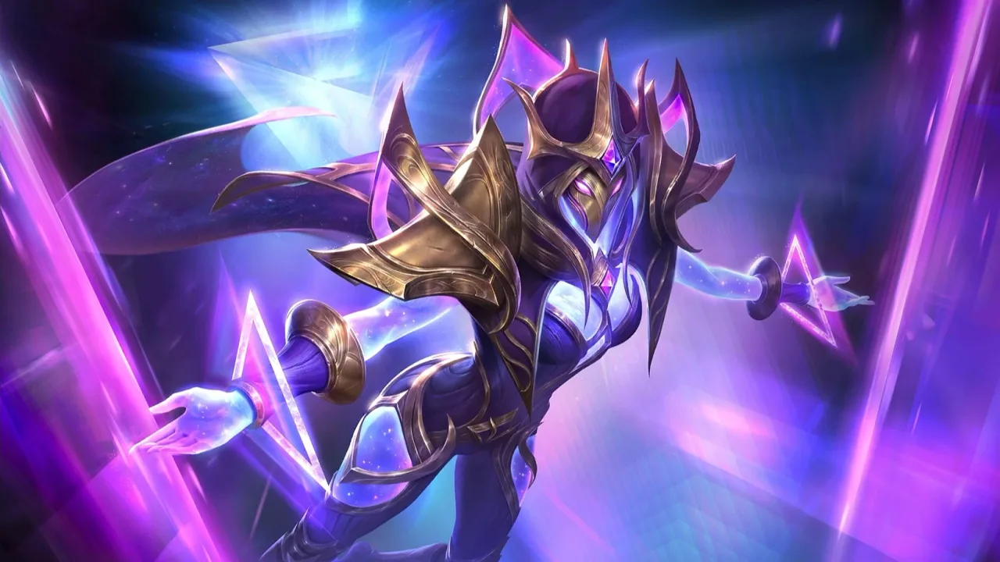
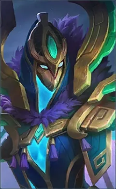

[Все скины](https://boostmlbb.ru/skins/)

[Скины](https://boostmlbb.ru/skins/)/Ив

# Скины Ив

Скинов

3

Можно купить

2

Последний

[Огненный лотос](https://boostmlbb.ru/skins/yve/flame-lotus.html)2025

[Профиль героя→](https://boostmlbb.ru/heroes/yve.html)

## Все скины

[Огненный лотосИсключительный · 2025](https://boostmlbb.ru/skins/yve/flame-lotus.html)[Защитница руинОбычный · 2022](https://boostmlbb.ru/skins/yve/ruin-protectress.html)[Лесной гимнОбычный · 2021](https://boostmlbb.ru/skins/yve/forest-hymn.html)

**Сколько стоит буст на герое Ив?**Выберите текущий и желаемый ранг. Стоимость появится на сайте.

[Рассчитать цену](https://boostmlbb.ru/order.html?type=hero)

## Частые вопросы

Сколько скинов у Ив?

3 скина без стандартного облика. Последний — «Огненный лотос» (Flame Lotus), 1 октября 2025.

Какие скины Ив можно купить сейчас?

«Защитница руин» (599 алмазов), «Лесной гимн» (269 алмазов). Остальные облики ограниченные и возвращаются только в событиях.

Какой самый редкий скин Ив?

«Огненный лотос» (Flame Lotus), класс исключительный, серия «Звёздный участник». Награда «Звёздного участника» в октябре 2025.
