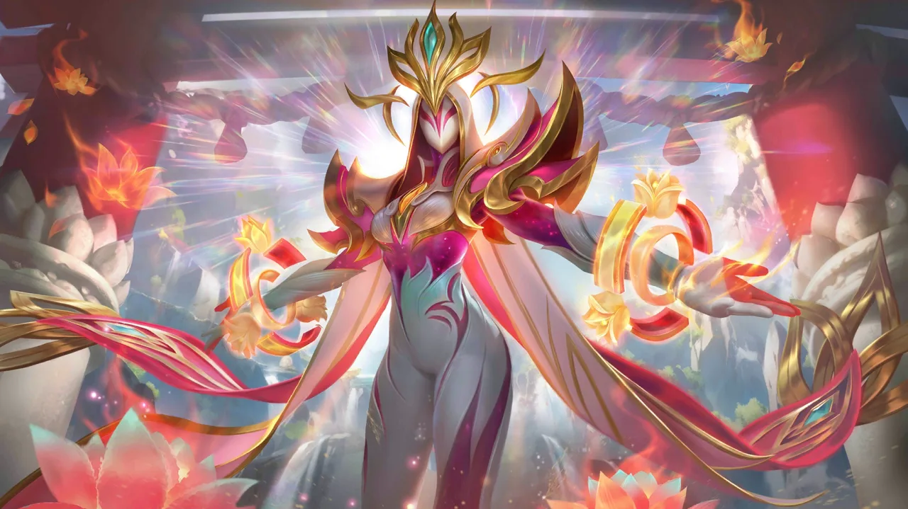

[Скины Ив](https://boostmlbb.ru/skins/yve.html)

[Скины](https://boostmlbb.ru/skins/)/[Ив](https://boostmlbb.ru/skins/yve.html)/Огненный лотос

[Скин Ив](https://boostmlbb.ru/skins/yve.html)

# Огненный лотос

Flame Lotus

Исключительный ExceptionalЗвёздный участникОграниченный

Как получить

Награда «Звёздного участника» в октябре 2025.

Вышел

1 октября 2025

## Что меняет облик

-   Новая внешность
-   Новые эффекты навыков
-   Анимация показа
-   Сцена показа
-   Бонус к характеристикам

## Все скины Ив [3](https://boostmlbb.ru/skins/yve.html)

[Огненный лотосИсключительный · 2025](https://boostmlbb.ru/skins/yve/flame-lotus.html)[Защитница руинОбычный · 2022](https://boostmlbb.ru/skins/yve/ruin-protectress.html)[Лесной гимнОбычный · 2021](https://boostmlbb.ru/skins/yve/forest-hymn.html)

## Серия «Звёздный участник»

[Морячка, рождённая приливомКалеа · 2026](https://boostmlbb.ru/skins/kalea/tideborn-sailor.html)[Тень кицунэХаябуса · 2026](https://boostmlbb.ru/skins/hayabusa/kitsune-s-shadow.html)[Клыки резниХанзо · 2026](https://boostmlbb.ru/skins/hanzo/fangs-of-slaughter.html)[Тлеющая крепостьБелерик · 2026](https://boostmlbb.ru/skins/belerick/smouldering-fortress.html)[Магитех­нический призракОбсидия · 2026](https://boostmlbb.ru/skins/obsidia/magitech-wraith.html)[Элизийское сияниеЦзэтянь · 2026](https://boostmlbb.ru/skins/zetian/elysian-luminance.html)[Батальон стражейХильда · 2026](https://boostmlbb.ru/skins/hilda/guardian-battalion.html)[Мечта­тельный коиХарли · 2026](https://boostmlbb.ru/skins/harley/dreaming-koi.html)

**Сколько стоит буст на герое Ив?**Выберите текущий и желаемый ранг. Стоимость появится на сайте.

[Рассчитать цену](https://boostmlbb.ru/order.html?type=hero)

## Частые вопросы

Как получить скин «Огненный лотос» на Ив?

Награда «Звёздного участника» в октябре 2025.

Когда вышел скин «Огненный лотос»?

1 октября 2025.

Какой класс у скина «Огненный лотос»?

Исключительный (Exceptional), серия «Звёздный участник».
