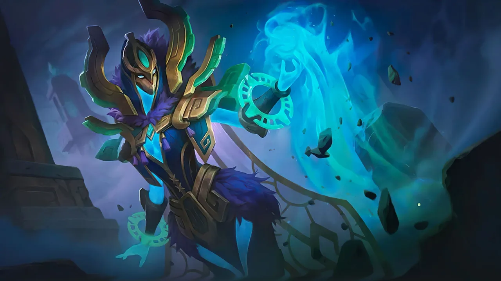

[Скины Ив](https://boostmlbb.ru/skins/yve.html)

[Скины](https://boostmlbb.ru/skins/)/[Ив](https://boostmlbb.ru/skins/yve.html)/Защитница руин

[Скин Ив](https://boostmlbb.ru/skins/yve.html)

# Защитница руин

Ruin Protectress

Обычный CommonЭлитныйВ продаже

Как получить

Продаётся в магазине обликов за 599 алмазов.

Цена

599 алмазов

Вышел

11 января 2022

## Что меняет облик

-   Новая внешность
-   Другой цвет эффектов
-   Анимация показа
-   Бонус к характеристикам

## Все скины Ив [3](https://boostmlbb.ru/skins/yve.html)

[Огненный лотосИсключительный · 2025](https://boostmlbb.ru/skins/yve/flame-lotus.html)[Защитница руинОбычный · 2022](https://boostmlbb.ru/skins/yve/ruin-protectress.html)[Лесной гимнОбычный · 2021](https://boostmlbb.ru/skins/yve/forest-hymn.html)

## Серия «Элитный»

[Золотой османтусЧан'Э · 2026](https://boostmlbb.ru/skins/change/golden-osmanthus.html)[Король-воена­чальникМартис · 2025](https://boostmlbb.ru/skins/martis/warlord-king.html)[Кадет открытого моряКимми · 2024](https://boostmlbb.ru/skins/kimmy/high-seas-cadet.html)[Зелёная копейщицаСильвана · 2024](https://boostmlbb.ru/skins/silvanna/verdant-lancer.html)[Мародёр Кровавое КопытоХилос · 2024](https://boostmlbb.ru/skins/hylos/bloodhoof-marauder.html)[Изящная бабочкаГвиневра · 2024](https://boostmlbb.ru/skins/guinevere/elegant-butterfly.html)[Маркиз клинковЛанселот · 2024](https://boostmlbb.ru/skins/lancelot/marques-of-blades.html)[Привал в пустошахЧип · 2024](https://boostmlbb.ru/skins/chip/badlands-hiatus.html)

**Сколько стоит буст на герое Ив?**Выберите текущий и желаемый ранг. Стоимость появится на сайте.

[Рассчитать цену](https://boostmlbb.ru/order.html?type=hero)

## Частые вопросы

Как получить скин «Защитница руин» на Ив?

Продаётся в магазине обликов за 599 алмазов.

Когда вышел скин «Защитница руин»?

11 января 2022.

Какой класс у скина «Защитница руин»?

Обычный (Common), серия «Элитный».
